# 設計・開発課 管理
## メンバー・マネージャー 操作ガイド

**配布前レビュー用原稿／2026年11月6日**

このガイドは、自分の仕事を確認し、必要な作業を登録し、完了や納期の相談を進めるためのものです。システム管理者向けの設定手順は扱いません。

画面は架空の名前・案件を使用した操作説明用です。実際のデータや利用できる操作は、ログインした役割と対象作業の状態によって異なります。

> 制作メモ：本文中の「制作メモ」は配布前に確認・解消し、利用者向け完成版から分離してください。本原稿は現行ソースとローカル表示の確認に基づき、本番配信版との一致は未確認です。

### 最初に読む場所

| あなたの目的 | 読む章 |
|---|---|
| 自分の作業をすぐ確認したい | 1 メンバーの最短スタート |
| チームの仕事を動かしたい | 2 マネージャーの最短スタート |
| 初めてログインする | 3 ログインと画面の見方 |
| 仕事を登録したい | 6〜7 メンバーの作成／10〜11 マネージャーの設定 |
| 作業を終えた・期限に間に合わない | 5 完了報告／8 納期変更 |
| 申請に判断を返したい | 12 申請の確認と判断 |
| 困った・ボタンが見つからない | 15 困ったとき |

## 1. メンバーの最短スタート

**到達目標：自分の作業・期限・次の操作が分かる。**

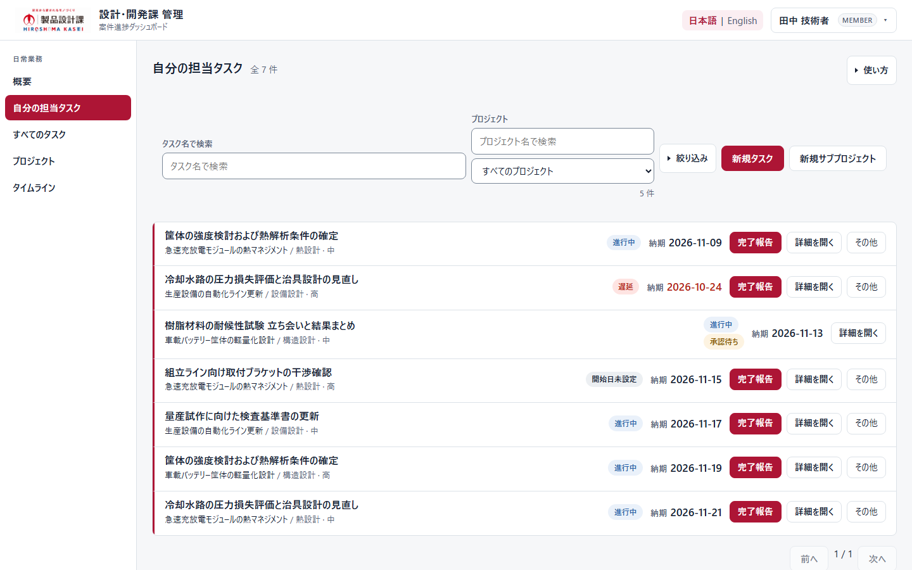

### まずはこの順番

1. 左メニューの「自分の担当タスク」をクリックします。
2. 一覧で、対象タスクの名前・プロジェクト・納期を確認します。
3. 「詳細を開く」をクリックし、仕事内容と担当を確認します。
4. 作業が終わったら、対象タスクの「完了報告」から実施内容を送ります。
5. 「受付完了」を確認したら、「自分の申請」で判断状況を確認します。

**完了の見分け方：**「受付完了」は申請が届いた状態です。「承認待ち」は判断前です。マネージャーが承認して初めてタスクの完了が確定します。

### 次の行動を選ぶ

| 状況 | 次にすること |
|---|---|
| 今日の仕事を探したい | 検索、プロジェクト選択、「絞り込み」を使う |
| 新しい自分の作業を登録したい | 「新規タスク」→第6章 |
| 納期の変更を相談したい | 対象タスクの「その他」→「納期変更を申請」→第8章 |
| 作成済みの名前や担当を直したい | マネージャーへ依頼する。作り直さない |
| 作業が見つからない | 絞り込みを解除し、担当・公開範囲をマネージャーに確認する |

> 最初から全画面を覚える必要はありません。「自分の担当タスク」「詳細を開く」「完了報告」の3つから始めましょう。

## 2. マネージャーの最短スタート

**到達目標：優先して確認する仕事と、判断待ちの申請が分かる。**

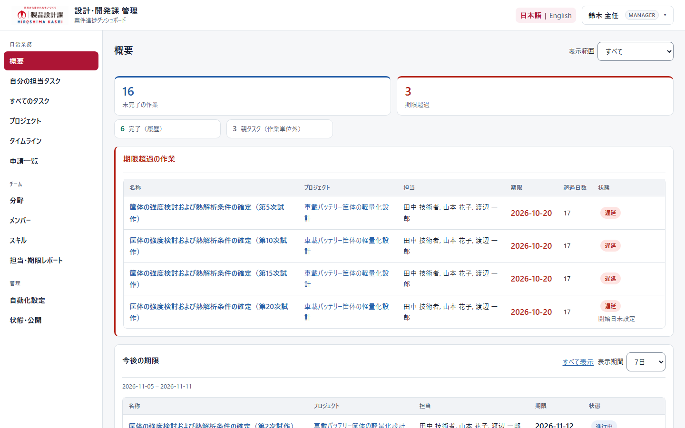

### 既存案件がある場合

1. 「概要」で期限超過と今後の期限を確認します。
2. 気になるタスクの名前をクリックして内容・担当・期限を確認します。
3. 「申請一覧」を開き、完了報告・納期変更申請を確認します。
4. 必要な変更はタスクの「編集」から行い、保存後の表示を確認します。
5. 週の見通しは「タイムライン」、担当別の確認は「担当・期限レポート」を使います。

### 初めて仕事を組み立てる場合

**分野を確認 → プロジェクトを作成 → 必要ならサブプロジェクト → タスク作成 → 担当・期限・公開範囲を確認**

新しい分野は、既存のものに当てはまらない場合だけ追加します。階層を深くすること自体を目的にせず、担当者が作業を見つけやすい構成にします。

**最初の設定完了の目安：**担当者が自分のアカウントで対象作業を見つけ、仕事内容・期限・完了報告の入口を確認できること。

> メール通知が届くことを設定完了の条件にしないでください。通知の有無と、画面上の登録・割当は別です。

## 3. ログインと画面の見方【共通】

### ログイン前に用意するもの

- 社内で案内された利用URL。
- 自分に発行された社員番号とパスワード。
- 登録する仕事の名称・担当・期限など、必要な情報。

1. 案内されたURLをブラウザーで開きます。
2. 「社員番号」「パスワード」を入力し、「ログイン」をクリックします。
3. 初回パスワード変更が求められた場合は画面の指示に従います。変更後に再ログインを求められたら、変更後のパスワードを使います。
4. 画面右上の氏名と役割が自分のものか確認します。

**制作メモ：**ログイン、初回パスワード変更、アカウントメニューの最新画面を追加撮影。認証情報は画像に入れない。

### 基本の操作

| 画面の場所 | 使い方 |
|---|---|
| 左のメニュー | 作業する画面へ移動する |
| 右上の「日本語｜English」 | 表示言語を切り替える。登録済みの案件名は翻訳されない |
| 右上の氏名・役割 | アカウントメニューを開き、パスワード変更やサインアウトを行う |
| 「その他」 | 一覧に出していない追加操作を開く |
| 「使い方」 | その画面の補足説明を開く |
| 「キャンセル」・×・Escape | 編集をやめる。送信開始後の通信取消とは異なる |

共有PCでは利用を終えたらサインアウトしてください。作成・編集フォームの入力が自動保存されるとは考えないでください。

### スマートフォンでは

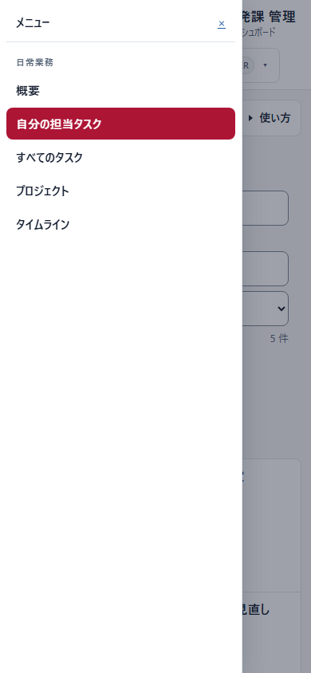

画面左上の「メニュー」を開いて移動先を選びます。PCの左メニューがそのまま常時表示されるわけではありません。表やタイムラインが横に長い場合は、その領域を横にスクロールします。

## 4. 仕事のまとまりと状態を理解する【共通】

### 仕事の構成

**分野 → プロジェクト → サブプロジェクト（必要な場合）→ タスク**

| 種類 | 使い分け | 例（架空） |
|---|---|---|
| 分野 | 複数の案件をまとめる業務領域 | 製品設計 |
| プロジェクト | 目的と成果を持つ案件 | 新型カバーの設計 |
| サブプロジェクト | 案件の中の工程・まとまり | 試作評価 |
| タスク | 担当者が進める具体的な作業 | 試作品の寸法を確認する |

タスク名は「何をするか」が分かる名前にします。説明には対象、成果物、確認事項を書きます。親タスクは子の作業をまとめる箱であり、親だけを直接完了報告する対象ではありません。

### 混同しやすい3つの状態

| 表示 | 意味 |
|---|---|
| 予定・進行中・遅延などの日程表示 | 日付や作業状態に基づく表示。日付が来たこと自体は完了報告ではない |
| 送信中・受付完了・送信結果不明 | 申請の通信・受付状況 |
| 承認待ち・承認済・却下・差戻し | 申請に対する判断状況 |

プロジェクトの色は識別の目印です。色だけで遅延や優先度を判断せず、状態の文字と期限を確認します。

**開始日・終了日と工数は別です。**日程の長さから労働時間や担当者の負荷を決めつけないでください。

## 5. 自分の作業を確認し、完了を報告する【メンバー】

### 5-1. 対象を見つける

開始画面：「自分の担当タスク」。

1. 「タスク名で検索」に名前の一部を入力します。
2. 必要ならプロジェクトを選びます。
3. 「絞り込み」を開き、「期限超過」「今週期限」「承認待ち」などを指定します。
4. 対象の「詳細を開く」で仕事内容と期限を確認します。

見つからない場合は検索・絞り込みを解除します。完了した作業は「完了したタスク」を確認します。別の人の作業を調べる場合は「すべてのタスク」や「プロジェクト」を使いますが、閲覧できることと編集できることは別です。

### 5-2. 完了報告を出す

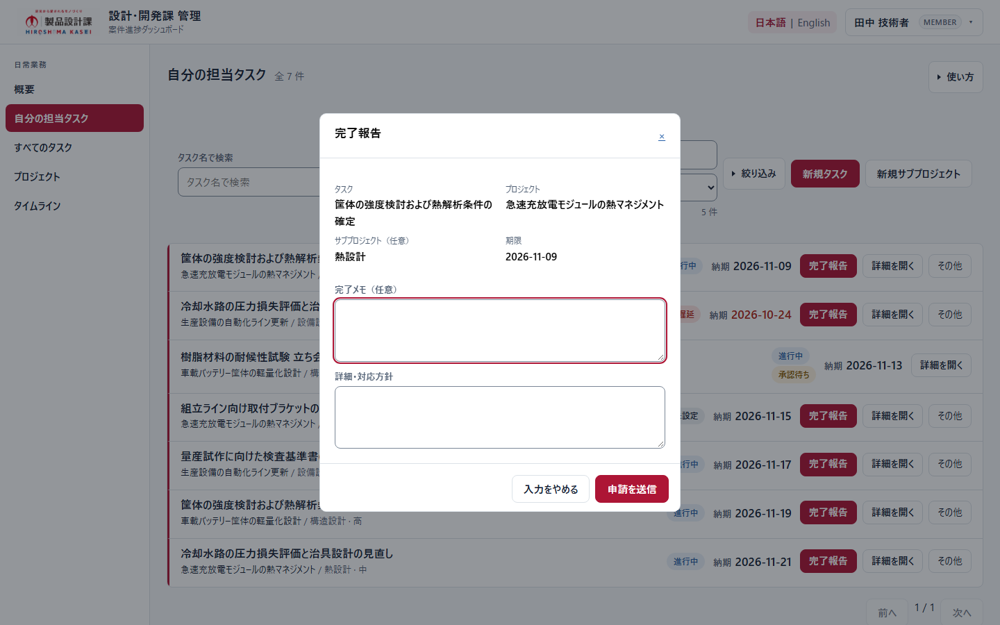

事前条件：対象作業が終わっており、報告可能な状態であること。親タスク、完了済み、受付停止中、既に申請がある作業などでは操作できない場合があります。

1. 対象タスクの「完了報告」をクリックします。
2. フォーム上部のタスク名・プロジェクト・期限を確認します。
3. 「完了メモ」に実施した内容を書きます。例：「寸法確認を実施し、図面との差異がないことを確認しました。」
4. 補足があれば「詳細・対応方針」に記入します。
5. 「申請を送信」を1回クリックします。
6. 「受付完了」と申請IDを確認し、「自分の申請」で判断を待ちます。

**結果：**報告を提出した段階では、タスクの完了は確定していません。マネージャーの承認後に、完了状態と履歴を確認します。

> 画面に「完了メモ（任意）」と表示されても、現行版では空欄で送れません。完了内容を必ず記入してください。

担当外でも閲覧可能で報告条件を満たす作業では完了報告ができる場合があります。他人の仕事を推測で報告せず、実施内容を確認してから提出してください。

## 6. 自分の新しいタスクを登録する【メンバー】

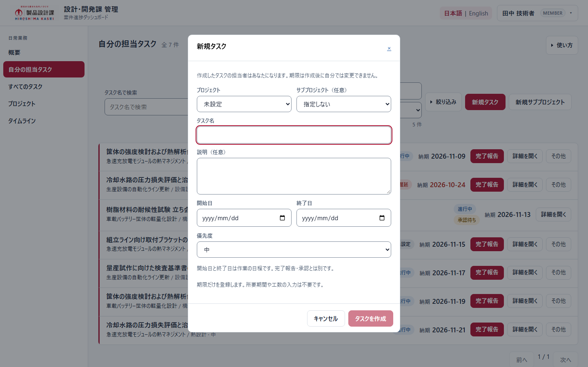

**目的：既存の案件に、自分が担当する具体的な作業を追加する。**

開始画面：「自分の担当タスク」→「新規タスク」。プロジェクト内から作成すると、作成先があらかじめ表示される場合もあります。

1. 「プロジェクト」と、必要な場合は「サブプロジェクト」を選びます。
2. 「タスク名」を入力します。
3. 「説明」に作業内容・成果物・確認事項を書きます。
4. 「終了日」を入力し、分かっていれば「開始日」も入力します。
5. 優先度と作成先を確認し、「タスクを作成」をクリックします。
6. 作成完了の表示と、作成先の一覧・詳細に登録された内容を確認します。

| 入力 | 扱い |
|---|---|
| プロジェクト | 必須 |
| サブプロジェクト | 任意。作成先に指定されている場合は確認する |
| タスク名 | 必須 |
| 説明 | 任意。ただし内容を共有するため記入を推奨 |
| 開始日 | 任意。入力する場合は終了日より後にしない |
| 終了日 | 必須 |
| 優先度 | 画面の選択肢から選ぶ |

**作成者が主担当になります。**別の人への割当や追加担当者の設定が必要な場合はマネージャーへ依頼してください。

非稼働日の期限などについて確認が出たら、日付を見直すか、表示された確認内容を理解したうえで進めます。期限が自動的に移動したと考えないでください。

**間違えて登録したら：**同じタスクを作り直さず、対象名・変更したい内容をマネージャーへ伝えます。メンバーは自分で作成した既存レコードも通常編集できません。

## 7. プロジェクト・サブプロジェクトを作る【メンバー】

### 7-1. まず既存案件を探す

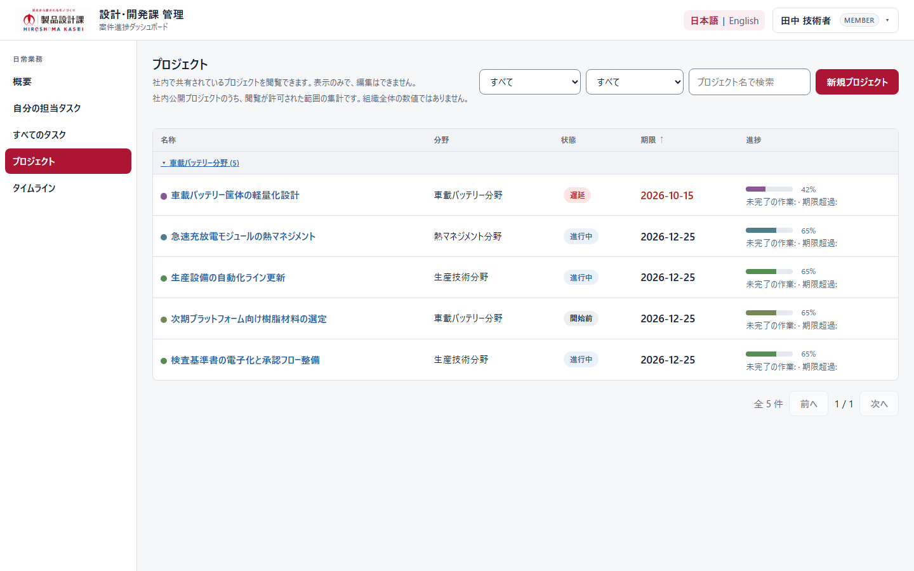

「プロジェクト」で名称や分野を検索します。既存の案件に属する作業なら、新しい案件を作らず、そのプロジェクトへ追加します。

### 7-2. 新しい案件を作る

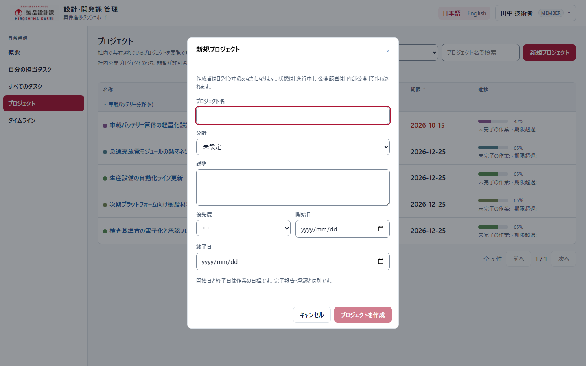

1. 「プロジェクト」→「新規プロジェクト」をクリックします。
2. 「プロジェクト名」を入力し、有効な「分野」を選びます。
3. 「説明」に案件の目的・成果を書きます。
4. 必要に応じて優先度・開始日・終了日を設定します。
5. 「プロジェクトを作成」をクリックします。
6. 作成した案件名と詳細を確認します。

必須はプロジェクト名と有効な分野です。メンバーの作成ではログイン中の本人が責任者となり、内部公開の案件として作成されます。公開してはいけない内容を入力する前に、マネージャーへ相談してください。作成は承認待ちの申請ではありません。

### 7-3. 工程をまとめる

「自分の担当タスク」の「新規サブプロジェクト」、またはプロジェクト内の作成操作を使います。

1. プロジェクトと、必要なら親サブプロジェクトを選びます。
2. サブプロジェクト名と説明を入力します。
3. 期限など表示される項目を確認し、「サブプロジェクトを作成」をクリックします。
4. 正しい案件・階層に表示されたか確認します。

**制作メモ：**サブプロジェクトの最新フォーム、作成後の画面を追加撮影。案件構成を説明する図は補助図として作り、実画面と混同させない。

## 8. 納期変更を相談する【メンバー】

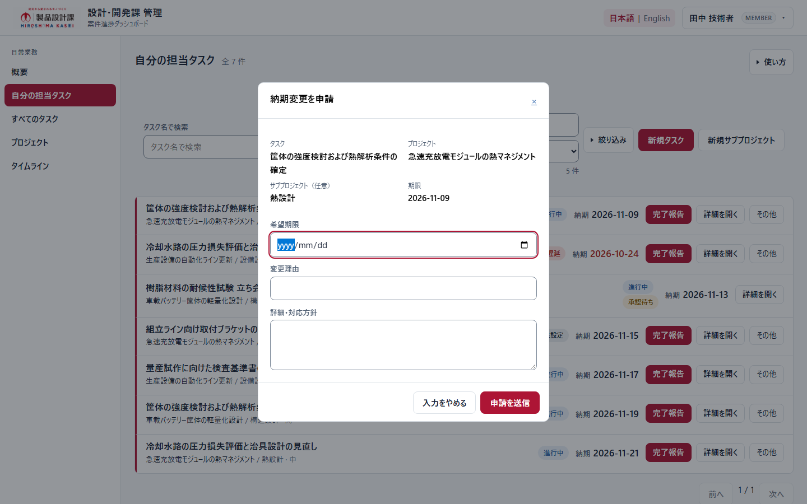

**目的：担当タスクの納期変更について、理由と希望日をマネージャーに伝える。**

1. 「自分の担当タスク」で対象を探します。
2. 対象の「その他」→「納期変更を申請」をクリックします。
3. タスク名・現在の期限を確認します。
4. 希望する期限を入力し、理由と対応方針を書きます。
5. 「申請を送信」を1回クリックし、受付結果を確認します。
6. 「自分の申請」で判断とメモを確認します。

記入例：「評価治具の入荷が遅れています。到着後に確認を行うため、終了日を○月○日へ変更したいです。事前に図面確認を進めます。」

希望期限の入力は必須です。理由・対応方針は、判断を早めるため具体的に書くことを推奨します。

**申請しただけでは期限は変わりません。**承認後、対象タスクの最新の期限を確認してください。担当していない作業の納期変更は、この申請経路の対象ではありません。

## 9. 申請の結果を確認する【メンバー】

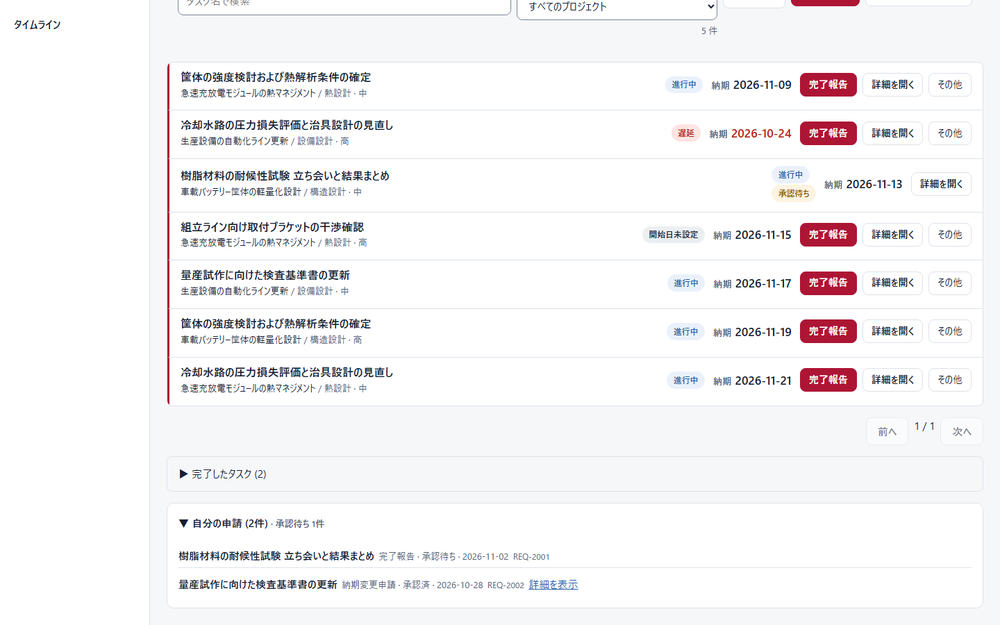

「自分の担当タスク」の下部にある「自分の申請」を開きます。必要なら「詳細を表示」で判断メモを確認します。

| 状況 | 意味と次の行動 |
|---|---|
| 送信中 | 受付結果を待つ。重ねて送信しない |
| 受付完了 | 届いた状態。承認済みとは限らない |
| 承認待ち | マネージャーの判断を待つ |
| 承認済 | 最新タスクの完了状態または期限を確認する |
| 差戻し・差し戻し | 判断メモを読み、内容を確認して相談・再提出する |
| 却下 | 申請は認められていない。期限や完了状態が変わったと思わない |
| 再確認が必要・最新ではありません | 提出後にタスクが変わった可能性がある。最新内容を確認する |
| 送信結果不明 | 受付済みの可能性もある。新しい申請を連投せず、履歴と対象を確認してマネージャーへ相談する |

送信開始後にフォームを閉じても、送信を取り消したことにはなりません。再提出できる条件は現在のタスク・申請状態によって異なります。

## 10. 案件を準備する【マネージャー】

### 10-1. 分野と担当者を確認する

「分野」で既存の領域を確認し、「メンバー」で必要な担当者が登録されているか確認します。使える分野・メンバーがない場合は運用担当者へ相談してください。

分野を追加する必要がある場合は「分野」→「新規分野」を開き、名称や画面で設定可能な内容を入力します。既存の分野をむやみに重複登録しないでください。主担当者変更など、権限上操作できない項目は運用担当者へ依頼します。

**制作メモ：**MANAGER の分野一覧・新規分野・メンバー参照画面を追加撮影。ADMIN の操作を代わりに載せない。

### 10-2. プロジェクトを作る

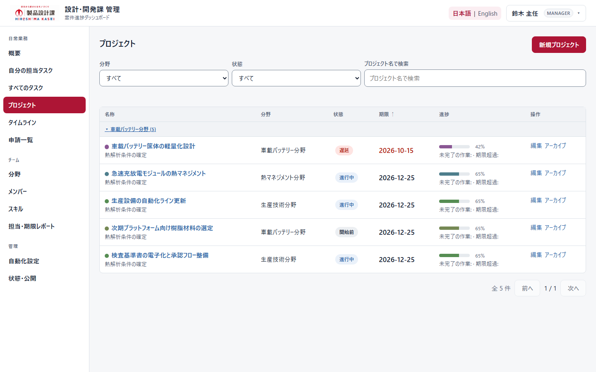

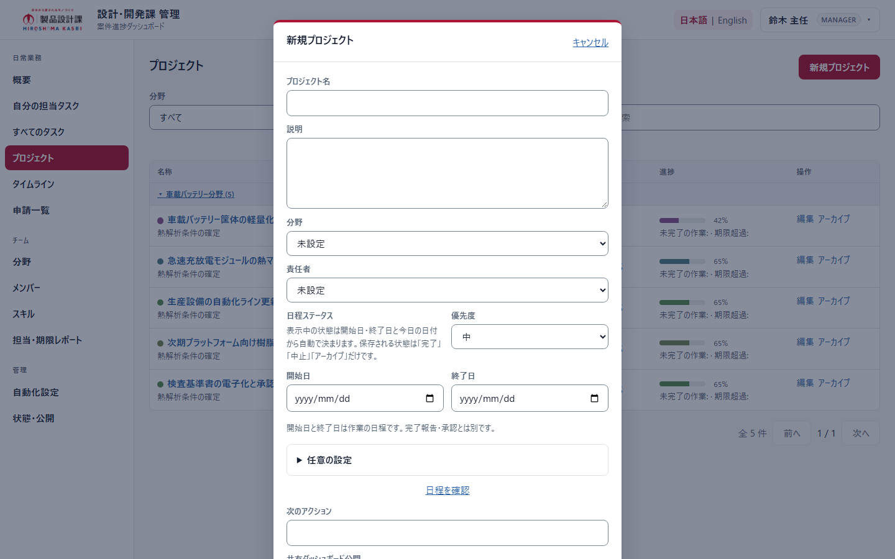

1. 「プロジェクト」→「新規プロジェクト」をクリックします。
2. 案件名・説明・分野を設定します。
3. 責任者・優先度を確認し、分かっている開始日・終了日を入力します。
4. フォーム下部を確認し、メンバーへ公開する案件か、制限する案件かを意図して選びます。
5. 入力内容と確認メッセージを読み、作成操作を確定します。
6. 案件の詳細を開き、名前・分野・責任者・期限・公開範囲を確認します。

> マネージャーには見えても、メンバーに見えるとは限りません。タスクを割り当てたことだけで、案件の公開設定が変わると考えないでください。

**制作メモ：**新規プロジェクト画像はフォーム上部です。下部の公開設定・確定ボタンを別画像で撮影し、実際のラベルを本文に反映。保存成功の画面も追加する。

## 11. 作業を分け、担当と期限を設定する【マネージャー】

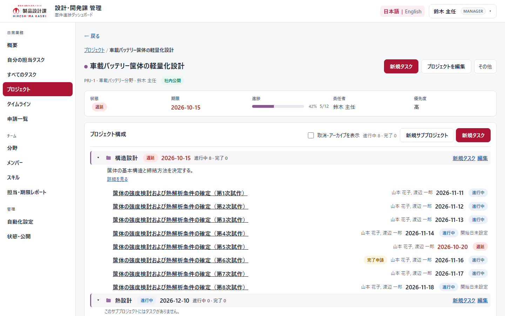

### 11-1. 作業を追加する

1. 対象プロジェクトを開きます。
2. 工程を分ける必要があれば「新規サブプロジェクト」で作成します。
3. 作業を置く場所の「新規タスク」をクリックします。
4. 作成先・タスク名・説明・日程を入力します。
5. 主担当と必要な追加担当者を設定します。
6. フォームの作成操作を確定し、正しい場所に表示されたか確認します。

主担当はその作業の責任者です。追加担当者がいても、タスクの期限・状態・完了判断は1つです。担当者ごとの完了率を別々に入力するものではありません。

### 11-2. 既存作業を編集する

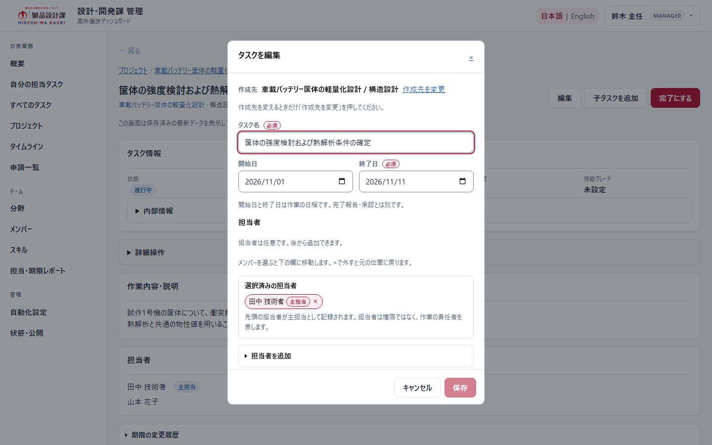

1. 対象タスクを開き、「編集」をクリックします。
2. 編集フォームの作成先と名前を確認します。
3. 変更が必要な項目だけを修正します。担当者は選択済み欄と主担当の表示を確認します。
4. 「保存」をクリックします。変更がないときは保存せず閉じます。
5. 一覧・詳細に反映された値を確認します。

期限変更などに確認が表示されたら、内容を読んで判断します。別の人の更新と競合した場合は、最新状態を読み直して変更内容を確認し直してください。

**制作メモ：**新規タスク、担当者追加、主担当表示、保存成功を追加撮影。編集画像を新規作成フォームの画像として使わない。

## 12. 完了報告・納期変更申請に判断を返す【マネージャー】

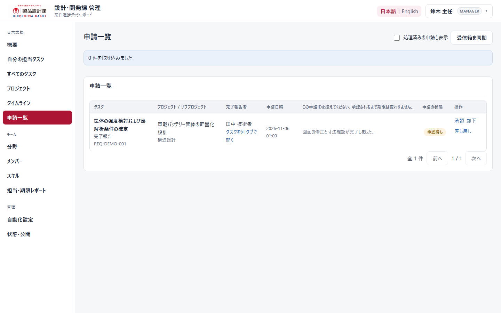

**目的：作業内容と依頼内容を確認し、申請者が次へ進める判断を返す。**

1. 「申請一覧」を開きます。
2. タスク名、プロジェクト、申請の種類、報告者、内容を確認します。
3. 必要なら「タスクを別タブで開く」で現在の内容を確認します。
4. 「承認」「却下」「差し戻し」のいずれかを選びます。
5. 確認画面で対象と判断内容を再確認し、必要な判断メモを書きます。
6. 確認操作を確定した後、申請状態とタスクの結果を確認します。

| 判断 | 意味 |
|---|---|
| 承認 | 完了報告なら作業完了、納期変更なら申請内容の変更を適用する |
| 却下 | 申請を認めない。申請だけを理由に期限や完了状態は変更されない |
| 差し戻し | 内容の再確認・補足が必要。何を直すか判断メモに書く |

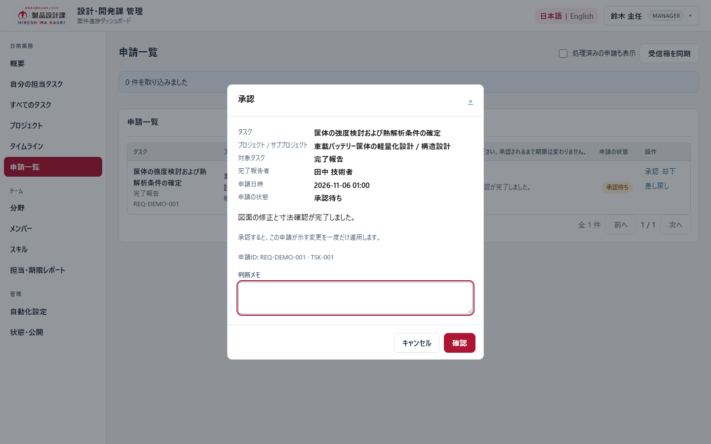

**判断メモ例：**「評価結果の保存先を追記してください」「希望期限で承認します。次工程の担当者にも共有してください」。

「最新ではありません」などが出た場合は、古い申請を無理に適用せず、現在のタスクと依頼内容を確認します。取り込み失敗の警告があるときは、一覧が空だから申請がないと決めつけないでください。

**制作メモ：**図G08/G09は架空の一覧・未確定の確認画面です。実際の承認・却下・差戻しを実行した証拠ではありません。配布前に隔離した検証環境で完了後表示を追加確認する。

## 13. マネージャー自身の判断で完了にする

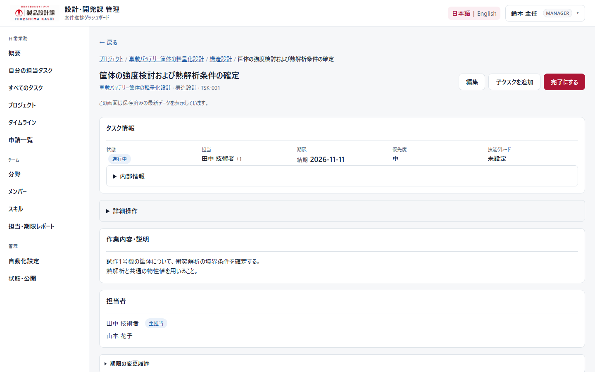

マネージャーが作業完了を直接確認できた場合、条件を満たすタスクには「完了にする」が表示されます。メンバーの「完了報告」とは異なる操作です。

1. タスク詳細で、対象・担当・仕事内容を確認します。
2. 実際に完了していることを確認します。
3. 「完了にする」をクリックします。
4. 確認メッセージを読み、対象が正しい場合だけ確定します。
5. タスクが完了したことを確認します。

保留中の完了報告がある場合、直接完了によって取り下げ扱いになることがあります。申請を承認する手順と、直接完了する手順を重ねて実施しないでください。

親タスクは子タスクの作業をまとめるもので、直接完了の対象ではありません。誤って完了にした場合は、自己判断で新しいタスクを作らず運用担当者へ相談してください。

**制作メモ：**直接完了の確認ダイアログ・完了後画面を追加撮影。ADMIN 専用の再開・訂正・削除操作は掲載しない。

## 14. 毎日の確認と週次の見直し

### メンバーの毎日

1. 「自分の担当タスク」で期限と今日進める内容を確認。
2. 不明点は詳細を確認し、必要ならマネージャーへ相談。
3. 終わった作業は完了報告。
4. 期限の変更が必要なら理由と希望日を早めに申請。
5. 「自分の申請」で判断メモを確認。

### マネージャーの毎日

1. 「概要」で期限超過と直近の期限を確認。
2. 「申請一覧」で判断待ちを確認。
3. 担当・期限・作業内容の不明点を整理。
4. 必要な編集・判断を行い、結果を確認。

### タイムラインで見通しを確認する【共通】

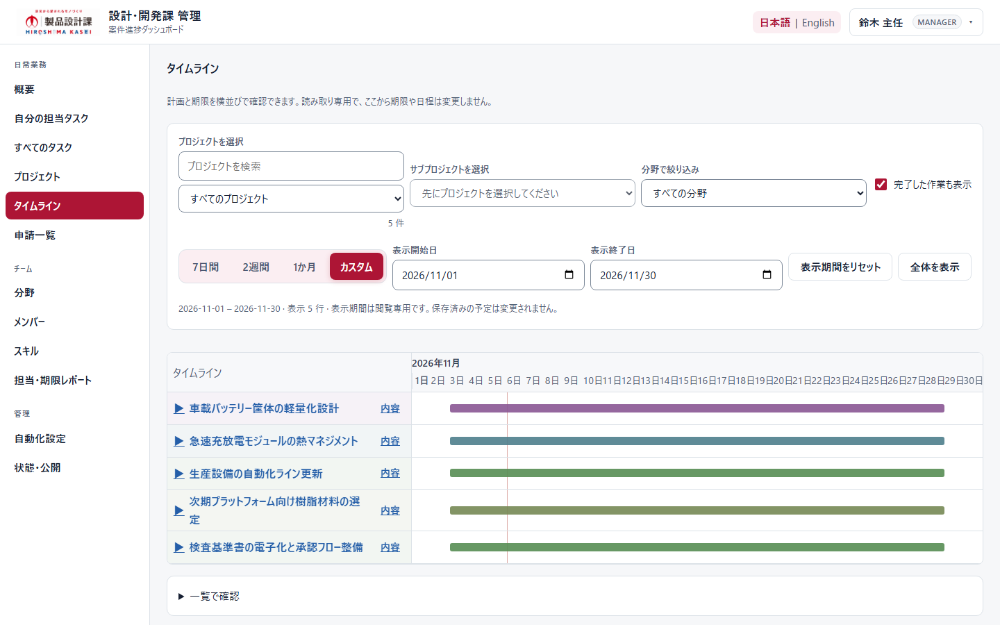

「タイムライン」でプロジェクト・分野・表示期間を指定します。階層の展開操作で中の作業を確認します。

**ここで期間を変更しても、作業の開始日・終了日は変わりません。**納期を変えるには、メンバーは納期変更申請、マネージャーは対象の編集または申請判断を使います。

### 担当・期限レポートを確認する【マネージャー】

「担当・期限レポート」で期間・メンバー・分野・プロジェクトを絞り込みます。表示される件数の意味と対象期間を確認し、必要に応じてメンバー別の内訳を開きます。

タスク数は労働時間ではありません。同じ件数でも作業の難しさや所要時間は異なります。複数担当の作業があると、ユニークなタスク数と担当の延べ件数は一致しない場合があります。

**制作メモ：**最新MANAGERレポート画面と、メンバーのタイムライン表示を追加撮影。架空の数値で負荷や業績の結論を示さない。

## 15. 困ったとき

| 困ったこと | 最初に確認すること | 次の行動 |
|---|---|---|
| ログインできない | 社内で案内されたURL、社員番号、入力方法 | 不明なら運用担当者へ。別人のアカウントを使わない |
| メニューが見つからない | スマートフォンでは「メニュー」。役割で表示が異なる | 役割が違う場合は運用担当者へ |
| タスクが表示されない | 検索・絞り込み、完了したタスク、ページ切替 | マネージャーに担当・公開範囲・保管状態を確認してもらう |
| メンバーに案件が見えない | 内部公開か、活動中か、正しい担当か | マネージャーが設定を確認する |
| 編集ボタンがない | メンバーは既存データを通常編集できない | マネージャーへ対象と修正内容を伝える |
| 保存できない | 必須入力、日付の前後関係、確認チェック | 画面に示された理由を直す。変更がなければ閉じる |
| 完了報告を送れない | 完了メモ、申請受付状態、既存申請、対象状態 | メモを入力し、表示された理由を確認する |
| 保存時に競合した | 他の人が更新していないか | 最新内容を読み直し、必要な変更だけやり直す |
| 送信結果不明 | 履歴に申請があるか、対象の状態 | 連投せず、申請ID・時刻・対象を控えて相談する |
| 完了報告したのに未完了 | 承認待ちかどうか | 申請の判断メモを確認する |
| 終了日を過ぎたのに完了にならない | 日程と完了処理を混同していないか | 実作業が終わったら完了報告・マネージャー判断を行う |
| 親タスクを完了できない | 子タスクがあるか | 子の作業を確認する |
| 間違えて作成・完了した | 正しい対象と修正したい内容 | マネージャーまたは運用担当者に相談。重複作成しない |

問い合わせには「画面名」「対象タスク・案件名」「操作」「表示メッセージ」「発生時刻」を添えます。パスワードは送らないでください。

## 16. 覚えておく操作の違い

| したいこと | メンバー | マネージャー |
|---|---|---|
| 自分の作業を見る | 自分の担当タスク | 自分の担当タスク |
| 案件を探す | 閲覧可能なプロジェクト | 管理対象のプロジェクト |
| 新しい仕事を登録 | 新規作成用フォーム | 管理用の新規作成フォーム |
| 既存の担当・説明を変更 | マネージャーに依頼 | 編集して保存 |
| 終わった仕事を伝える | 完了報告 | 完了報告、または条件に合う直接完了 |
| 完了報告・納期変更を判断 | 判断結果を確認 | 申請一覧で判断 |
| 期限を変更したい | 担当作業の納期変更を申請 | 編集または申請判断 |
| 日程を見比べる | タイムライン | タイムライン・担当別レポート |

> まず「何をする仕事か」「誰が担当か」「いつまでか」を確認し、実施後は「受付」と「完了」を分けて確認しましょう。
