# 設計・開発課 管理 { .cover-title }

## メンバー（MEMBER）・マネージャー（MANAGER）操作マニュアル { .cover-sub }

版 1.0｜2026年11月6日｜対象：設計・開発課 管理 の利用者

この冊子は、日々の仕事を「見つける・進める・相談する」ための操作ガイドです。画面の全機能を順番に説明するのではなく、あなたが達成したい仕事の順に並べています。

| 項目 | 内容 |
|---|---|
| 対象 | メンバー（MEMBER）、マネージャー（MANAGER） |
| 扱うこと | 自分の担当の確認、完了報告、納期変更申請、案件・作業の登録、担当と日程の設定、申請への判断 |
| 扱わないこと | システム管理者向けの設定、アカウントの発行、権限の付与、データの復元 |

> **画面写真について**
>
> 掲載している画面は、社内の確認用環境で架空の氏名・案件を表示したものです。実在のデータではありません。画面写真は配布前の確認用で、実際に配布する版と表示が異なる場合があります。写真の差し替えが必要な箇所は〔要撮影〕と表示しています。

> **この資料の約束**
>
> ボタン名は「」で囲み、画面に表示されている日本語のまま書いています。役割、対象の状態、申請の受付設定によって、表示されない操作があります。

本版は配布前レビュー版です。写真の差し替え箇所は〔要撮影〕と表示しています。配布前に「配布前レビュー・チェックリスト」で未確認事項を解消してください。

## 目次と読み方

### あなたの目的から探す

| あなたの目的 | 読む章 |
|---|---|
| まず画面になれる | 第1章 ログインと画面の見方（p.3） |
| 仕事のまとまり方を知りたい | 第2章 分野・プロジェクト・タスク（p.5） |
| 「受付完了」と「完了」の違いを知りたい | 第3章 3つの状態を区別する（p.6） |
| 自分の担当と期限を確認したい | 第4章 今日の担当を確認する（p.7） |
| 終わった作業を報告したい | 第5章 完了報告を出す（p.8） |
| 期限に間に合わないので相談したい | 第6章 納期変更を申請する（p.9） |
| 自分の申請がどうなったか知りたい | 第7章 申請の結果を確認する（p.10） |
| 自分の作業を登録したい | 第8章 自分のタスクを登録する（p.11） |
| 案件を探したい・作りたい | 第9章 案件を探す・作る（p.12） |
| 工程（サブプロジェクト）を作りたい | 第10章 サブプロジェクトを作る（p.14） |
| チームの状況をつかみたい | 第11章 概要で優先を決める（p.15） |
| 案件を用意したい | 第12章（p.16）・第13章（p.17） |
| 作業を分け、担当と期限を決めたい | 第14章（p.18）・第15章（p.19） |
| 申請に判断を返したい | 第17章（p.21）・第18章（p.22） |
| マネージャー自身で完了を判断したい | 第16章 タスク詳細と直接完了（p.20） |
| 日程の見通しを立てたい | 第19章 タイムライン（p.23） |
| 担当ごとの件数を見たい | 第20章 担当・期限レポート（p.24） |
| 毎日・毎週なにを見るか知りたい | 第21章 毎日の確認と週次の見直し（p.25） |
| 困った | 第22章 困ったとき（p.26） |

### 本書の読み方

- **「」** は画面に表示されているボタン名・項目名です。言い換えずにそのまま探してください。
- **①〜⑤** は画面写真の中の番号です。本文の同じ番号と対応します。
- 各章は「目的 → 開始画面 → 事前条件 → 操作 → 完了の見分け方 → 次の行動」の順で書いています。
- 「必須」は入力しないと先に進めない項目、「推奨」は入力すると後の判断が早くなる項目です。

> **最初の1日はここだけ**
>
> メンバー（MEMBER）は第4章「今日の担当を確認する」まで、マネージャー（MANAGER）は第11章「概要で優先を決める」までを読めば、その日の仕事を始められます。完了報告や新規登録は、必要になったときに読み返してください。

第1部　共通

## 第1章　ログインと画面の見方

<table class="lesson">
<tr><th>目的</th><td>正しい本人アカウントで「設計・開発課 管理」に入り、自分の役割と画面の場所が分かる。</td></tr>
<tr><th>開始画面</th><td>ログイン画面（社内で案内された利用URL）</td></tr>
<tr><th>事前条件</th><td>自分に発行された社員番号とパスワード、社内で案内されたURLがある。</td></tr>
</table>

### 操作

1. 案内されたURLをブラウザーで開きます。
2. 「社員番号」と「パスワード」を入力します。
3. 「ログイン」を押します。
4. 初回は仮パスワードの変更を求められます。画面の指示に従って「現在のパスワード」「新しいパスワード（4〜128文字）」「新しいパスワードを再入力」を入力します。
5. 変更後は再ログインを求められます。変更後のパスワードで入り直します。
6. 画面右上の氏名と役割（MEMBER／MANAGER）が自分のものか確認します。

〔要撮影〕ログイン画面、初回パスワード変更、アカウントメニュー。認証情報は写真に写さない。

**完了の見分け方：** 左のメニューが表示され、右上に自分の氏名と役割が出ていれば入れています。役割が自分の立場と違う場合は、作業を始める前に運用担当者へ連絡してください。

**次の行動：** 第4章（メンバー）または第11章（マネージャー）へ進みます。

### 画面の基本

| 画面の場所 | 使い方 |
|---|---|
| 左のメニュー | 画面を切り替える。日常業務・チーム・管理の順に並ぶ |
| 右上の「日本語｜English」 | 表示言語を切り替える。登録済みの案件名や説明は翻訳されない |
| 右上の氏名 | アカウントメニューを開く。「パスワード変更」「サインアウト」がある |
| 「使い方」 | その画面の補足説明を開く |
| 「入力をやめる」「キャンセル」「閉じる」 | 入力をやめる。送信を始めた後の通信取消とは異なる |

> **共通の注意**
>
> 入力内容が自動で保存されるとは考えないでください。共有のパソコンを使ったら、最後にアカウントメニューから「サインアウト」します。

### スマートフォン・狭い画面では

<figure>
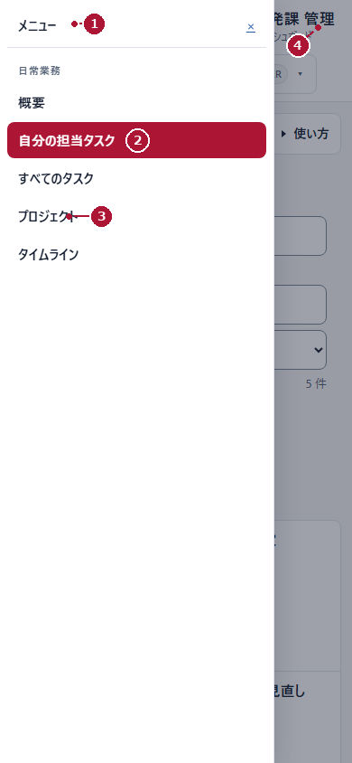
<figcaption>図C01　メンバー（MEMBER）／狭い画面でのメニュー（架空データ）</figcaption>
</figure>

1. 画面左上の「メニュー」①を押します。
2. 移動したい画面（例：「自分の担当タスク」②、「プロジェクト」③）を選びます。
3. 用が済んだら「メニューを閉じる」（×）④で閉じます。

パソコンの左メニューは、狭い画面では常に表示されません。表やタイムラインが横に長いときは、その領域を横にスクロールします。

## 第2章　分野・プロジェクト・タスク

<table class="lesson">
<tr><th>目的</th><td>仕事のまとまり方と、自分が登録するときに選ぶ場所が分かる。</td></tr>
<tr><th>開始画面</th><td>どの画面でもよい</td></tr>
<tr><th>事前条件</th><td>なし</td></tr>
</table>

**分野 → プロジェクト → サブプロジェクト（必要な場合）→ タスク** の順に、仕事が整理されています。

| 種類 | 何をまとめるか | 例（架空） |
|---|---|---|
| 分野 | 複数の案件をまとめる業務領域 | 車載バッテリー分野 |
| プロジェクト | 目的と成果を持つ案件 | 車載バッテリー筐体の軽量化設計 |
| サブプロジェクト | 案件の中の工程・まとまり | 構造設計、熱設計 |
| タスク | 担当者が進める具体的な作業 | 筐体の強度検討および熱解析条件の確定 |

### 名前の付け方

- **タスク名**は「何をするか」が分かる名前にします。例：「試作品の寸法を確認する」。
- **説明**には、対象・成果物・確認してほしいことを書きます。
- 階層を深くすること自体を目的にしないでください。担当者が自分の作業を見つけやすい構成にします。

### 親タスクは「箱」

子タスクを持つタスクは、作業をまとめる箱です。箱そのものを完了報告するのではなく、中の子タスクを進めます。箱の進み具合は子タスクから集計されます。

> **色は目印**
>
> プロジェクトごとの色は、案件を見分けるための目印です。色だけで遅延や優先度を判断せず、状態の文字と期限を確認してください。

## 第3章　3つの状態を区別する

<table class="lesson">
<tr><th>目的</th><td>「受付完了」「承認待ち」「完了」を混同せず、次に何をすればよいか判断できる。</td></tr>
<tr><th>開始画面</th><td>どの画面でもよい</td></tr>
<tr><th>事前条件</th><td>なし</td></tr>
</table>

画面には、性格の違う3種類の表示が混ざっています。

| 種類 | 表示の例 | 意味 |
|---|---|---|
| 日程・作業の状態 | 開始前、進行中、遅延、完了、開始日未設定 | 日付と作業の進み具合による表示。日付が来たこと自体は完了ではない |
| 申請の通信・受付 | 送信中、受付完了、送信結果不明 | 申請がサーバーに届いたかどうか |
| 申請への判断 | 承認待ち、承認済、却下、差戻し、再確認が必要 | マネージャー（MANAGER）の判断結果 |

### 覚えるべき1点

> **「受付完了」は、申請が届いた状態です。作業が完了した状態ではありません。**
>
> 完了報告は、マネージャー（MANAGER）が承認して初めてタスクの完了になります。納期変更も、承認されて初めて期限が変わります。

### よくある誤解

| 誤解 | 実際 |
|---|---|
| 完了報告を送れば、その場でタスクが完了する | 送信直後は「承認待ち」。承認後に完了 |
| 申請を出せば期限がすぐ変わる | 承認されるまで期限は変わらない |
| 期限を過ぎたので自動的に完了になる | 期限は予定。完了には報告と承認が要る |
| 子タスクを持つ親タスクを完了報告できる | 子タスクから進める。親は集計 |
| 送信中に閉じれば送信は取り消される | 閉じても送信は続く。結果を確認する |

**次の行動：** メンバー（MEMBER）は第4章、マネージャー（MANAGER）は第11章へ。

第2部　メンバー（MEMBER）

## 第4章　今日の担当を確認する

<table class="lesson">
<tr><th>目的</th><td>自分の担当タスク、期限、次に取る行動が分かる。</td></tr>
<tr><th>開始画面</th><td>メンバー（MEMBER）／「自分の担当タスク」</td></tr>
<tr><th>事前条件</th><td>ログイン済み。担当が設定されている。</td></tr>
</table>

<figure>
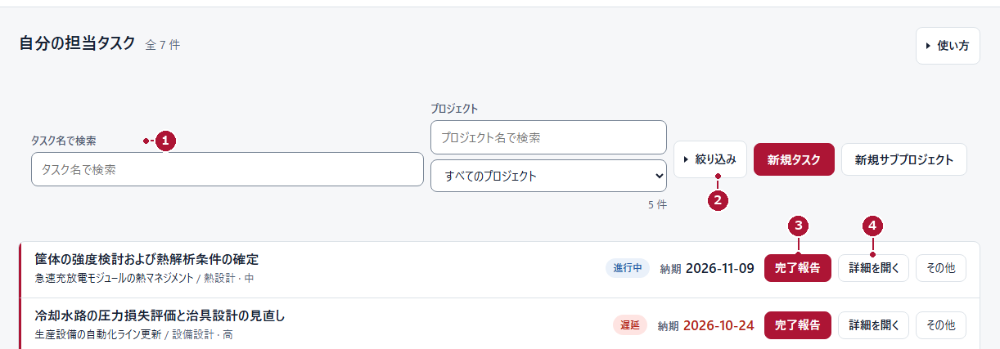
<figcaption>図M01　メンバー（MEMBER）／自分の担当タスク（架空データ）</figcaption>
</figure>

### 操作

1. 左メニューの「自分の担当タスク」を押します。
2. 一覧で、対象タスクの名前・プロジェクト・期限・状態を確認します。
3. 目的の作業が決まっているときは「タスク名で検索」①に名前の一部を入力します。
4. 条件で絞るときは「絞り込み」②を開き、「期限超過」「今週期限」「承認待ち」などを選びます。
5. 内容を確かめたいタスクの「詳細を開く」④を押します。
6. 作業が終わっているタスクは「完了報告」③から報告します（第5章）。

**完了の見分け方：** 一覧に自分の担当が表示され、対象タスクの期限と状態が読めていれば目的は達成です。この画面を開いたこと自体は、作業の完了ではありません。

**次の行動：** 内容を確認して作業に着手します。期限に間に合わない見込みなら第6章、終わったら第5章へ。

### つまずきやすい点

- 一覧に作業が出ないときは、検索語と絞り込みを解除します。完了した作業は「完了したタスク」に入ります。
- 表示されるのは自分に関係する範囲です。組織全体の件数ではありません。
- 「承認待ち」の付いたタスクは、申請の判断待ちです。重ねて報告しません。

## 第5章　完了報告を出す

<table class="lesson">
<tr><th>目的</th><td>終えた作業の内容をマネージャー（MANAGER）へ伝え、判断を依頼する。</td></tr>
<tr><th>開始画面</th><td>メンバー（MEMBER）／「自分の担当タスク」</td></tr>
<tr><th>事前条件</th><td>対象の作業が終わっている。対象が報告できる状態である（完了済み・子タスク持ち・受付停止中・既に申請ありの場合は報告できない）。</td></tr>
</table>

<figure>
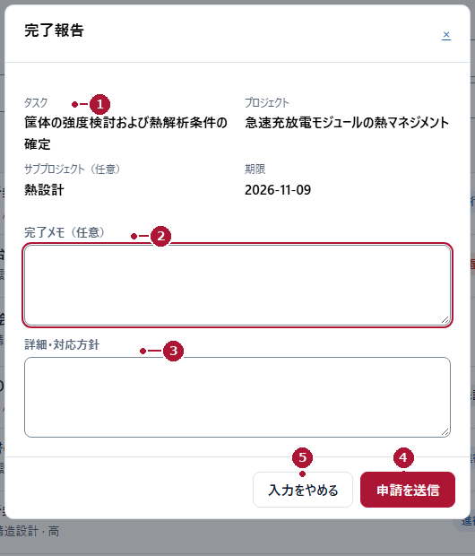
<figcaption>図M02　メンバー（MEMBER）／完了報告フォーム（架空データ）</figcaption>
</figure>

### 操作

1. 対象タスクの「完了報告」を押します。
2. フォーム上部の「タスク」①とプロジェクト・サブプロジェクト・期限が対象で正しいか確認します。
3. 「完了メモ（任意）」②に、実施した内容を書きます。
4. 補足や引き継ぎ事項があれば「詳細・対応方針」③に書きます。
5. 「申請を送信」④を1回だけ押します。
6. 「受付完了」と申請IDが表示されたら、内容を控えます。

〔要撮影〕送信中の表示（「送信中…」）、「受付完了」と申請IDの表示、受付停止や送信結果不明の表示。

**完了の見分け方：** ダイアログが閉じ、画面に「受付完了」と申請IDが出ていれば、申請は届いています。この時点では**タスクは完了していません**。タスクの状態は「承認待ち」です。

**次の行動：** 第7章の手順で「自分の申請」を開き、判断を待ちます。承認されたらタスクの状態を確認します。

> **完了メモは必ず記入します。** 画面には「完了メモ（任意）」と表示されますが、空欄のままでは送信できません。何をして何を確認したかを書いてください（例：「寸法確認を実施し、図面との差異がないことを確認しました。」）。未確認の点や引き継ぎは「詳細・対応方針」へ。送信中は「申請を送信」が「送信中…」に、左のボタンが「閉じる」に変わりますが、閉じても送信は取り消されません。

## 第6章　納期変更を申請する

<table class="lesson">
<tr><th>目的</th><td>担当している作業の期限について、希望日と理由をマネージャー（MANAGER）へ伝える。</td></tr>
<tr><th>開始画面</th><td>メンバー（MEMBER）／「自分の担当タスク」</td></tr>
<tr><th>事前条件</th><td>対象が自分が担当している作業で、完了していない。</td></tr>
</table>

<figure>
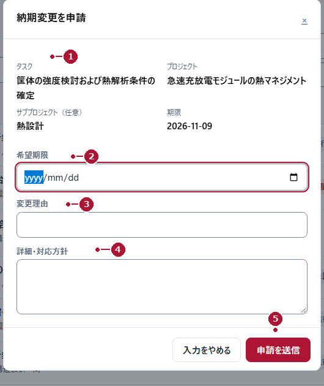
<figcaption>図M03　メンバー（MEMBER）／納期変更申請フォーム（架空データ）</figcaption>
</figure>

### 操作

1. 「自分の担当タスク」で対象タスクを探します。
2. 対象タスクの「その他」を押し、「納期変更を申請」を選びます。
3. 上部の「タスク」①と現在の期限が対象で正しいか確認します。
4. 「希望期限」②に、変更したい日付を入力します。
5. 「変更理由」③に理由を、「詳細・対応方針」④に代替案を書きます。
6. 「申請を送信」⑤を1回だけ押し、「受付完了」を確認します。

**完了の見分け方：** 「受付完了」と申請IDが表示されれば届いています。**この時点では期限は変わっていません。** タスクの期限は、承認されるまで元のままです。

**次の行動：** 第7章で判断を確認します。承認後にタスクの期限が更新されていることを確かめます。

### 書き方の例（架空）

> 評価治具の入荷が遅れています。到着後に確認を行うため、終了日を1週間後へ変更したいです。待ち時間に図面の事前確認を進めます。

**希望期限**は必須です。**変更理由**と**詳細・対応方針**は推奨で、具体的に書くと判断が早くなります。

> **担当していない作業は対象外です。** 他の人の作業は、マネージャー（MANAGER）に相談してください。

## 第7章　申請の結果を確認する

<table class="lesson">
<tr><th>目的</th><td>自分が出した申請がどう判断されたかを読み、次の行動を決める。</td></tr>
<tr><th>開始画面</th><td>メンバー（MEMBER）／「自分の担当タスク」（画面下部）</td></tr>
<tr><th>事前条件</th><td>申請を1件以上出している。</td></tr>
</table>

<figure>
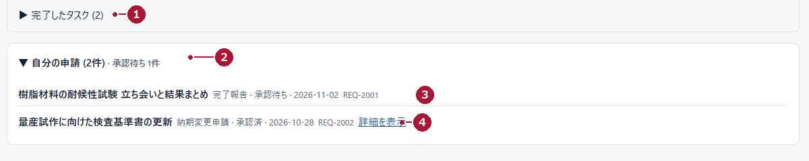
<figcaption>図M07　メンバー（MEMBER）／完了したタスクと自分の申請（架空データ）</figcaption>
</figure>

### 操作

1. 「自分の担当タスク」の下部までスクロールします。
2. 完了した作業は「完了したタスク」①で確認できます。
3. 「自分の申請」②を開きます。
4. 申請ごとに、種別・状態・日付・申請ID③を確認します。
5. 判断メモを読みたいときは「詳細を表示」④を押します。

**完了の見分け方：** 一覧に自分の申請が並び、状態（承認待ち・承認済・却下・差戻しなど）が読めていれば確認できています。

**次の行動：** 状態に応じて、下の表のとおりに進みます。

| 状態 | 意味 | 次にすること |
|---|---|---|
| 送信中 | 受付結果を待っている | 重ねて送信しない。表示が変わるまで待つ |
| 受付完了 | サーバーに届いた | 判断待ち。状態の変化を確認する |
| 承認待ち | マネージャー（MANAGER）の判断前 | 待つ。必要なら口頭で補足する |
| 承認済 | 判断された | タスクの完了状態、または新しい期限を確認する |
| 差戻し | 内容の再確認・補足が必要 | 判断メモを読み、内容を直して相談・再提出する |
| 却下 | 申請は認められなかった | 判断メモを読み、別の進め方を相談する |
| 再確認が必要 | 提出後にタスクが変わった | 最新のタスク内容を確認してから相談する |
| 送信結果不明 | 届いたか分からない | 連投しない。申請ID・時刻・対象を控えて相談する |

> **申請IDは控えてください**
>
> 問い合わせのときは「画面名・対象タスク・申請ID・発生時刻」を伝えると、確認が早くなります。パスワードは伝えないでください。

## 第8章　自分のタスクを登録する

<table class="lesson">
<tr><th>目的</th><td>既存の案件に、自分が担当する具体的な作業を追加する。</td></tr>
<tr><th>開始画面</th><td>メンバー（MEMBER）／「自分の担当タスク」→「新規タスク」</td></tr>
<tr><th>事前条件</th><td>追加先のプロジェクトが決まっている。作業名・期限が分かっている。</td></tr>
</table>

<figure>
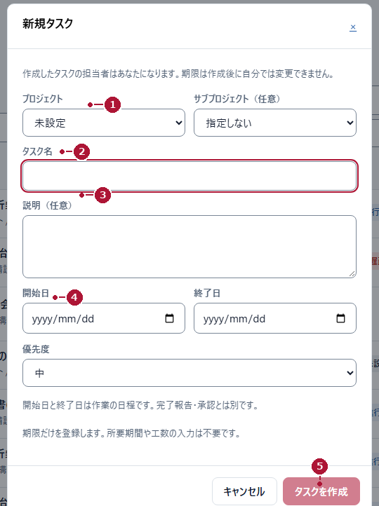
<figcaption>図M04　メンバー（MEMBER）／新規タスク（架空データ）</figcaption>
</figure>

**画面の案内文：** 「作成したタスクの担当者はあなたになります。期限は作成後に自分では変更できません。」

### 操作

1. 「新規タスク」を押します。
2. 「プロジェクト」①を選びます。工程がある場合は「サブプロジェクト（任意）」も選びます。
3. 「タスク名」②を入力します。
4. 「説明（任意）」③に、対象・成果物・確認事項を書きます。
5. 「開始日」「終了日」④を入力し、優先度を選びます。
6. 「タスクを作成」⑤を押します。

**完了の見分け方：** ダイアログが閉じ、一覧または作成先の階層に、登録したタスク名が表示されます。

**次の行動：** 一覧で期限と作成先を確認します。担当や期限を後から変えたいときは、マネージャー（MANAGER）へ依頼します。

### 入力の必須と推奨

- **必須：** プロジェクト、タスク名、終了日（期限）。終了日は作成後に自分では変更できません。
- **任意（記入を推奨）：** サブプロジェクト、説明、開始日。開始日は終了日より後にしません。
- **優先度**は画面の選択肢から選びます（初期値のままでよい）。

> **開始日と終了日は「予定」です。** 完了報告や承認とは別の項目です。日程の長さから工数や負荷を決めつけないでください。

> **作り直さない。** 間違えたときは同じタスクを作らず、対象名と直したい内容をマネージャー（MANAGER）へ伝えます。メンバー（MEMBER）は、自分が作った既存のタスクも通常は編集できません。

## 第9章　案件を探す・作る

<table class="lesson">
<tr><th>目的</th><td>既存の案件を見つけ、必要なら新しい案件を登録する。</td></tr>
<tr><th>開始画面</th><td>メンバー（MEMBER）／「プロジェクト」</td></tr>
<tr><th>事前条件</th><td>新規作成の場合は、案件名と、当てはまる分野が分かっている。</td></tr>
</table>

<figure>
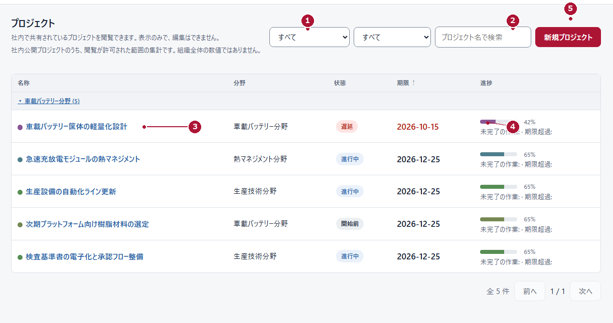
<figcaption>図M05　メンバー（MEMBER）／閲覧できるプロジェクト（架空データ）</figcaption>
</figure>

**画面の案内文：** 「社内で共有されているプロジェクトを閲覧できます。表示のみで、編集はできません。」

### 9-1　まず既存の案件を探す

1. 「プロジェクト」を押します。
2. 絞り込みの選択欄①で分野や状態を選ぶか、「プロジェクト名で検索」②に名前の一部を入力します。
3. 目的の案件名③を押して詳細を開きます。
4. 進み具合は進捗④で確認します。色だけで判断せず、状態と期限も見ます。

既存の案件に属する作業なら、新しい案件を作らず、そのプロジェクトにタスクを追加します（第8章）。

### 9-2　新しい案件を作る

<figure>
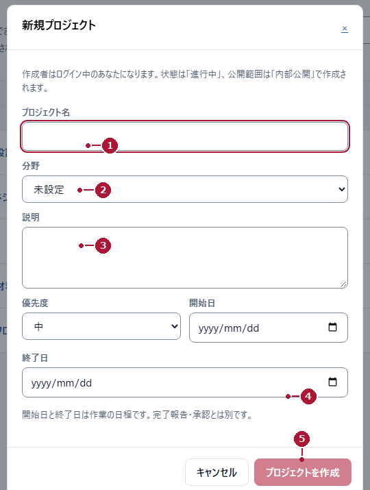
<figcaption>図M06　メンバー（MEMBER）／新規プロジェクト（架空データ）</figcaption>
</figure>

**画面の案内文：** 「作成者はログイン中のあなたになります。状態は「進行中」、公開範囲は「内部公開」で作成されます。」

1. 「新規プロジェクト」⑤を押します。
2. 「プロジェクト名」①を入力します。
3. 「分野」②で、当てはまる分野を選びます。
4. 「説明」③に、案件の目的と成果を書きます。
5. 必要に応じて優先度・「開始日」「終了日」④を設定します。
6. 「プロジェクトを作成」⑤を押します。

**完了の見分け方：** 一覧に新しい案件名が表示され、詳細に自分の名前と分野が出ています。これは申請ではなく、その場で作成されます。

**次の行動：** 案件の中にタスクを追加します（第8章）。担当者を自分以外にしたいとき、公開範囲を変えたいときは、マネージャー（MANAGER）へ依頼します。

> **公開してよい内容か確認**
>
> メンバー（MEMBER）が作る案件は内部公開で作成されます。社外に出せない情報や、公開してはいけない案件名・説明を書く前に、マネージャー（MANAGER）へ相談してください。

## 第10章　サブプロジェクトを作る

<table class="lesson">
<tr><th>目的</th><td>案件の中に、工程やまとまり（サブプロジェクト）を作って作業を整理する。</td></tr>
<tr><th>開始画面</th><td>メンバー（MEMBER）／「自分の担当タスク」右上</td></tr>
<tr><th>事前条件</th><td>作成先のプロジェクトが決まっている。</td></tr>
</table>

〔要撮影〕「新規サブプロジェクト」の入力画面と作成後の表示。別画面での代用は不可。

### 操作

1. 「自分の担当タスク」右上の「新規サブプロジェクト」を押します。
2. 「作成する内容」で「サブプロジェクトを作成」を選びます。
3. 「プロジェクト」を選び、必要なら「親サブプロジェクト（任意）」を選びます。
4. 「サブプロジェクト名」を入力します。
5. 「サブプロジェクトを作成」を押します。

**完了の見分け方：** 対象プロジェクトの階層に、作成したサブプロジェクト名が表示されます。

**次の行動：** その中にタスクを追加します（第8章）。階層が違う場所にできた場合は、作り直さずマネージャー（MANAGER）へ相談します。

> **階層は作りすぎない**
>
> 工程を細かく分けるほど探しにくくなります。担当者が目的の作業にたどり着けるかを基準にしてください。

第3部　マネージャー（MANAGER）

## 第11章　概要で優先を決める

<table class="lesson">
<tr><th>目的</th><td>今日、どの案件・作業を優先して見るかを決める。</td></tr>
<tr><th>開始画面</th><td>マネージャー（MANAGER）／「概要」</td></tr>
<tr><th>事前条件</th><td>ログイン済みで、対象の案件・作業が見える範囲にある。</td></tr>
</table>

<figure>
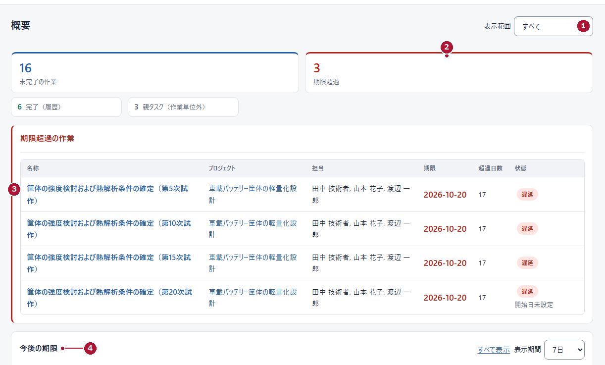
<figcaption>図G01　マネージャー（MANAGER）／概要（架空データ）</figcaption>
</figure>

### 操作

1. 左メニューの「概要」を押します。
2. 右上の「表示範囲」①で、見たい範囲（すべて、または特定の分野）を選びます。
3. 上段の「期限超過」②の件数を確認します。
4. 「期限超過の作業」の一覧で、対象の作業名③を押して内容を開きます。
5. 下段の「今後の期限」④で、直近の期限を確認します。表示期間は「7日」「14日」「1か月」から選べます。

**完了の見分け方：** 期限超過の件数と、今後期限が来る作業が把握でき、次に開く作業が決まっていれば目的は達成です。

**次の行動：** 判断待ちの申請を確認するなら第17章へ。担当や期限を変えるなら第14章・第15章へ。

### 数字の読み方

**未完了の作業**はまだ終わっていない件数、**期限超過**は期限を過ぎた件数、**完了（履歴）**は完了した件数です。**親タスク（作業単位外）**は子をまとめる箱で、作業として数えません。

> **件数を足し算しない。** 数え方が違うため、合計を「総作業数」と考えないでください。

## 第12章　案件を準備する（一覧）

<table class="lesson">
<tr><th>目的</th><td>担当者が見つけられる案件を用意し、対象の案件をすぐ開ける。</td></tr>
<tr><th>開始画面</th><td>マネージャー（MANAGER）／「プロジェクト」</td></tr>
<tr><th>事前条件</th><td>ログイン済み。案件の名前と目的が決まっている。</td></tr>
</table>

<figure>
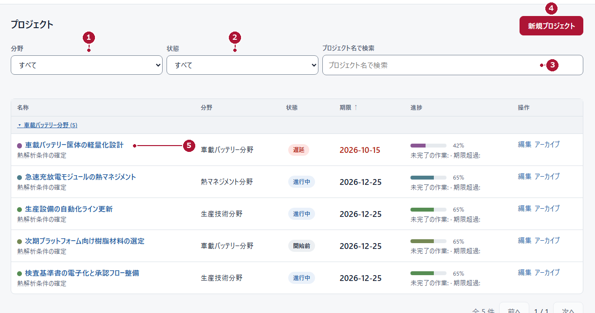
<figcaption>図G02　マネージャー（MANAGER）／プロジェクト一覧（架空データ）</figcaption>
</figure>

### 操作

1. 左メニューの「プロジェクト」を押します。
2. 「分野」①と「状態」②で絞り込みます。
3. 目的の案件が見えなければ「プロジェクト名で検索」③に名前の一部を入力します。
4. 案件名⑤を押して詳細を開きます。
5. 新しく作るときは「新規プロジェクト」④を押します（第13章）。

**完了の見分け方：** 対象の案件が一覧に出て、状態・期限・進捗が読めています。

**次の行動：** 案件の中の作業を整える場合は第14章へ。

### 一覧の見方

| 列 | 見方 |
|---|---|
| 状態・期限 | 遅延・進行中・開始前などの表示。赤い日付は期限超過 |
| 進捗 | 完了した割合。「未完了の作業・期限超過」の件数も見る |
| 操作 | 「編集」「アーカイブ」。アーカイブは記録を残したまま一覧から外す |

> **アーカイブは削除ではありません。** 終わった案件や、いったん止める案件はアーカイブします。削除が必要な場面はこの冊子では扱いません。運用担当者に相談してください。

## 第13章　案件を登録する（フォーム）

<table class="lesson">
<tr><th>目的</th><td>案件名・分野・責任者・日程・公開範囲を決めて、案件を登録する。</td></tr>
<tr><th>開始画面</th><td>マネージャー（MANAGER）／「プロジェクト」→「新規プロジェクト」</td></tr>
<tr><th>事前条件</th><td>案件名、担当する分野、責任者が決まっている。</td></tr>
</table>

<figure>
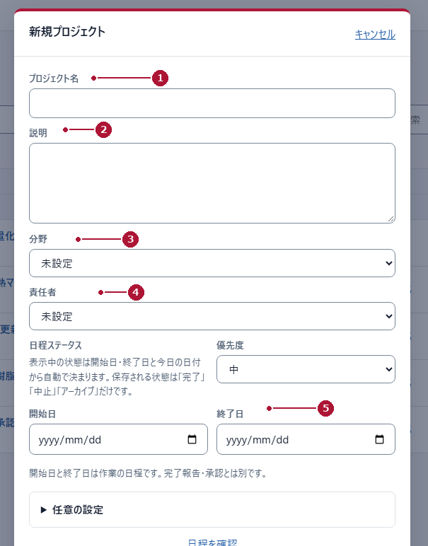
<figcaption>図G07　マネージャー（MANAGER）／新規プロジェクトのフォーム（架空データ・下部は未撮影）</figcaption>
</figure>

### 操作

1. 「新規プロジェクト」を押してフォームを開きます。
2. 「プロジェクト名」①を入力します。
3. 「説明」②に、目的・成果・前提を書きます。
4. 「分野」③で、この案件をまとめる分野を選びます。
5. 「責任者」④を選び、優先度を確認します。
6. 「開始日」「終了日」⑤を入力します。
7. フォーム下部までスクロールし、公開範囲を確認して、確定の操作を押します。

〔要撮影〕フォーム下部（「共有ダッシュボード公開」「プロジェクト要約」、確定ボタン）と、保存後の表示。

**完了の見分け方：** 一覧に新しい案件が表示され、詳細に名前・分野・責任者・期限・公開範囲が出ています。

**次の行動：** 案件の中に工程と作業を作ります（第14章）。

### 入力の必須と推奨

| 項目 | 扱い | 補足 |
|---|---|---|
| プロジェクト名 | 必須 | 担当者が内容を想像できる名前 |
| 分野 | 必須 | 既存の分野から選ぶ |
| 説明・責任者・日程 | 推奨 | 何を達成する案件か。責任者は決めてから登録 |
| 公開範囲 | 必須 | 内部公開か限定かを意図して選ぶ |

> **公開範囲は次回の公開処理で反映されます。** 「社内公開 (INTERNAL)」にしても、共有ダッシュボードがその場で更新されるわけではありません。分野の作成や責任者の変更など、権限上できない操作は運用担当者に相談してください。

## 第14章　作業を分ける

<table class="lesson">
<tr><th>目的</th><td>案件の中に工程と作業を作り、担当者が自分の作業を見つけられる状態にする。</td></tr>
<tr><th>開始画面</th><td>マネージャー（MANAGER）／案件の詳細</td></tr>
<tr><th>事前条件</th><td>対象の案件が登録されている。作業の内容と順序が決まっている。</td></tr>
</table>

<figure>
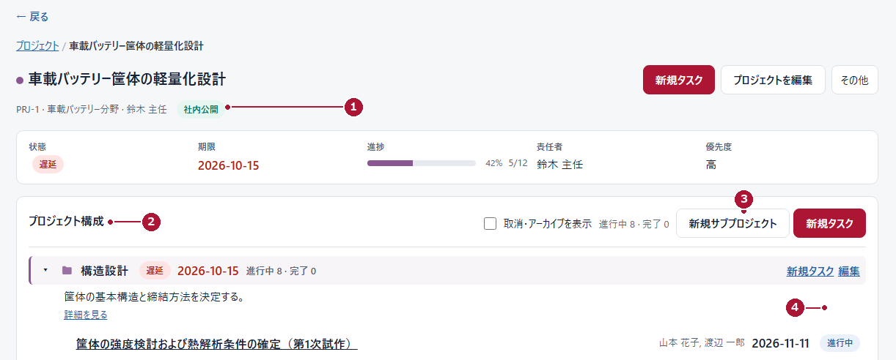
<figcaption>図G03　マネージャー（MANAGER）／案件詳細とプロジェクト構成（架空データ）</figcaption>
</figure>

### 操作

1. 「プロジェクト」から対象の案件を開きます。
2. 上部で案件名と要約①（ID・分野・責任者・公開範囲）を確認します。
3. 「プロジェクト構成」②で、現在の工程と作業を見ます。
4. 工程を分ける場合は「新規サブプロジェクト」③を押して作成します。
5. 作業を追加する位置の「新規タスク」④を押します。
6. 作成先・作業名・説明・日程・担当を入力して確定します。

**完了の見分け方：** 追加した作業が、意図した工程の下に表示されています。

**次の行動：** 担当と日程を詰めます（第15章）。担当者へ「自分の担当タスク」を見るよう伝えます。

### 構成の考え方

- 工程は「誰がどこまでを受け持つか」が分かる単位にします。
- 作業は1人（または1つの担当グループ）が進められる大きさにします。
- 作業の階層と、作業の順序（依存関係）は別のものです。順序は依存関係として設定します。
- 親になる作業は、子の作業をまとめる箱です。親だけを完了報告の対象にしないでください。

> **階層の上限**
>
> サブプロジェクトは案件の下に4階層まで、作業は3階層までです。それ以上深いものは親に選べません。

## 第15章　担当と日程を設定する

<table class="lesson">
<tr><th>目的</th><td>作業の担当者・開始日・期限を確定し、責任の所在を明確にする。</td></tr>
<tr><th>開始画面</th><td>マネージャー（MANAGER）／作業の「編集」</td></tr>
<tr><th>事前条件</th><td>対象の作業が存在する。担当者の候補が登録されている。</td></tr>
</table>

<figure>
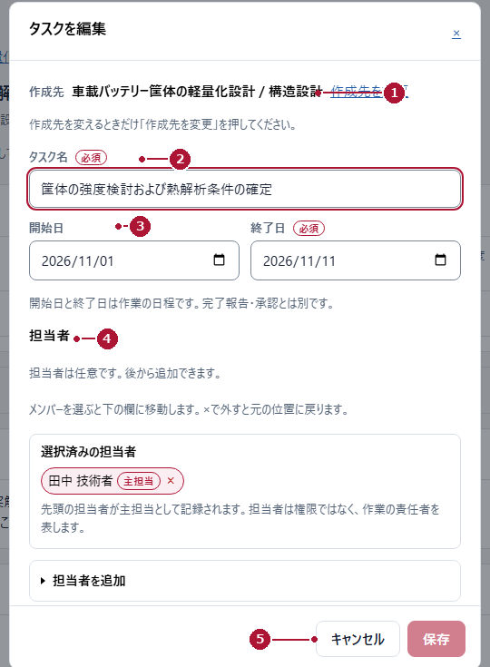
<figcaption>図G04　マネージャー（MANAGER）／タスクを編集（架空データ）</figcaption>
</figure>

### 操作

1. 対象の作業を開き、「編集」を押します。
2. 上部の「作成先」①が正しいか確認します。変えるときだけ「作成先を変更」を押します。
3. 「タスク名」②を確認し、必要なら直します。
4. 「開始日」「終了日」③を入力します。終了日は必須です。
5. 「担当者」④で担当を選びます。追加するときは「担当者を追加」を開きます。
6. 「保存」⑤を押します。

**完了の見分け方：** 詳細画面に戻り、担当者・期限・状態が保存した内容で表示されています。

**次の行動：** 担当者へ依頼内容を伝えます。メールが届くことを前提にしないでください。

### 担当の決まり

- **主担当**はその作業の責任者です。選択済みの担当者の先頭に「主担当」と表示されます。
- **追加担当者**は一緒に進める人です。作業は1つのままで、期限・状態・完了判断も1つです。担当者ごとの完了率は入力しません。
- 担当者は権限ではありません。作業の責任者を表す表示です。変更がないときは保存せずに閉じます。

## 第16章　タスク詳細と直接完了

<table class="lesson">
<tr><th>目的</th><td>作業の内容・担当・期限を確認し、必要ならマネージャー（MANAGER）の判断で完了にする。</td></tr>
<tr><th>開始画面</th><td>マネージャー（MANAGER）／作業の詳細</td></tr>
<tr><th>事前条件</th><td>作業が実作業として存在し、子タスクを持っていない。</td></tr>
</table>

<figure>
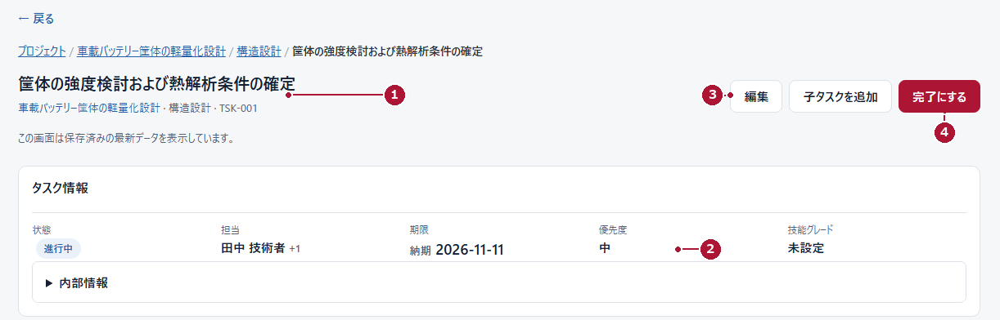
<figcaption>図G05　マネージャー（MANAGER）／タスク詳細（架空データ）</figcaption>
</figure>

### 16-1　内容を確認する

1. 一覧や概要から対象の作業を開きます。
2. 作業名①と、その下の案件・工程・作業IDを確認します。
3. 「状態・担当・期限」②と「作業内容・説明」⑤を読み、依頼した内容と一致しているか確かめます。
4. 直す必要があれば「編集」③を押します（第15章）。

### 16-2　直接完了にする

1. 対象の作業が実際に終わっていることを確認します。
2. 「完了にする」④を押します。
3. 確認メッセージを読み、対象が正しいときだけ確定します。
4. 状態が「完了」になったことを確認します。

**完了の見分け方：** 作業の状態が「完了」になり、期限の変更履歴などに記録が残ります。

**次の行動：** 関係者へ完了を伝えます。次の工程があれば、その作業の担当と期限を確認します。

> **申請の承認と直接完了は別のルートです。** メンバー（MEMBER）の完了報告は「申請一覧」で承認します。マネージャー（MANAGER）自身が完了を確認できた場合だけ「完了にする」を使います。同じ作業で両方を重ねないでください。

> **確認メッセージを読み、子タスクを持つ親タスクは対象外と心得る。** 承認待ちの報告がある作業で直接完了すると、その報告は取り下げ扱いになります。先に申請を確認し、誤って完了にした場合は運用担当者へ相談します。

## 第17章　申請一覧を開く

<table class="lesson">
<tr><th>目的</th><td>メンバー（MEMBER）から届いた完了報告・納期変更申請を把握する。</td></tr>
<tr><th>開始画面</th><td>マネージャー（MANAGER）／「申請一覧」</td></tr>
<tr><th>事前条件</th><td>ログイン済み。</td></tr>
</table>

<figure>
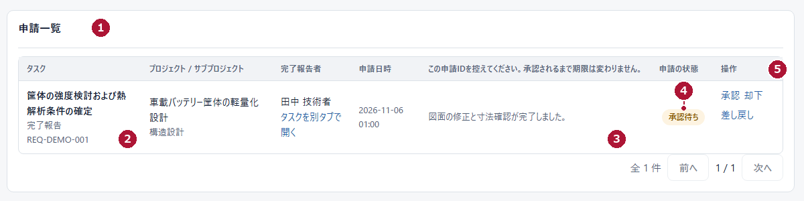
<figcaption>図G08　マネージャー（MANAGER）／申請一覧（架空データ）</figcaption>
</figure>

### 操作

1. 左メニューの「申請一覧」①を押します。
2. 画面上部の取り込み結果（例：「0 件を取り込みました」）を確認します。
3. 一覧で、対象のタスクと種別・申請ID②を確認します。
4. 申請内容③を読みます。
5. 「申請の状態」④が「承認待ち」であることを確認します。
6. 処理するときは「操作」⑤の「承認」「却下」「差し戻し」のいずれかを押します（第18章）。

**完了の見分け方：** 未処理の申請が一覧に並び、対象・種別・内容・状態が読めています。

**次の行動：** 内容を確認して判断します（第18章）。判断の前に、必要なら「タスクを別タブで開く」で現在の作業内容を確認します。

### この画面で分かること

| 列 | 見方 |
|---|---|
| タスク | 申請の対象。種別（完了報告／納期変更申請）と申請IDも表示される |
| プロジェクト / サブプロジェクト | 対象の置き場所 |
| 完了報告者・申請日時 | 報告した人の表示名（本人確認をした意味ではない）と届いた日時 |
| 申請の状態・操作 | 承認待ち・処理中・承認済・却下・差戻しなどと、判断の入口 |

- 画面を開くと、新しい申請の取り込みが自動で行われます。件数は新しく取り込まれた数です。手動で取り込み直すときは「受信箱を同期」を押します。
- 処理済みの申請も見たいときは「処理済みの申請も表示」にチェックを入れます。

> **一覧が空でも安心しない。** 取り込みに失敗したときは警告が表示されます。一覧が空だからといって「申請がない」と決めつけず、警告の内容を確認してから「受信箱を同期」を試してください。

## 第18章　承認・却下・差し戻し

<table class="lesson">
<tr><th>目的</th><td>申請内容を確認し、申請者が次へ進める判断を返す。</td></tr>
<tr><th>開始画面</th><td>マネージャー（MANAGER）／「申請一覧」</td></tr>
<tr><th>事前条件</th><td>対象の申請が「承認待ち」である。</td></tr>
</table>

<figure>
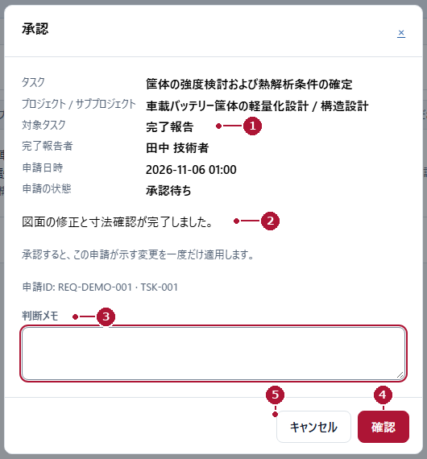
<figcaption>図G09　マネージャー（MANAGER）／承認の確認画面（架空データ）</figcaption>
</figure>

### 操作

1. 「申請一覧」で対象の申請の「承認」「却下」「差し戻し」のいずれかを押します。
2. 確認画面で「対象タスク」①が正しいか確認します。
3. 申請内容②（報告内容、または希望期限と理由）を読みます。
4. 「判断メモ」③に、申請者へ伝える内容を書きます。
5. 「確認」④を押します。
6. 一覧に戻り、申請の状態と、対象タスクの結果を確認します。

**完了の見分け方：** 申請の状態が「承認済」「却下」「差戻し」のいずれかに変わり、対象タスクの状態または期限が反映されています。

**次の行動：** 申請者へ結果を伝えます。判断メモを見るよう案内してください。

### 3つの判断の使い分け

| 判断 | 意味 | 対象タスクへの影響 |
|---|---|---|
| 承認 | 申請内容を認める | 完了報告なら完了、納期変更なら期限を適用する |
| 却下 | 申請を認めない | 申請だけを理由に、期限や完了状態は変わらない |
| 差し戻し | 内容の再確認・補足が必要 | 状態は差戻し。何を直すかを判断メモに書く |

### 判断メモの例（架空）

- 「評価結果の保存先を追記してください。」（差し戻し）
- 「希望期限で承認します。次工程の担当者にも共有してください。」（承認）

> **一度だけ適用されます。** 確認画面には「承認すると、この申請が示す変更を一度だけ適用します。」と表示されます。同じ申請を何度も承認しないでください。「最新ではありません」と出た申請は、古い内容を適用せず、現在のタスクを確認してから判断します。

## 第19章　タイムラインで見通す

<table class="lesson">
<tr><th>目的</th><td>案件と期限を横に並べて見て、日程の重なりや余裕を確認する。</td></tr>
<tr><th>開始画面</th><td>マネージャー（MANAGER）／「タイムライン」</td></tr>
<tr><th>事前条件</th><td>案件と作業に日程が入っている。</td></tr>
</table>

<figure>
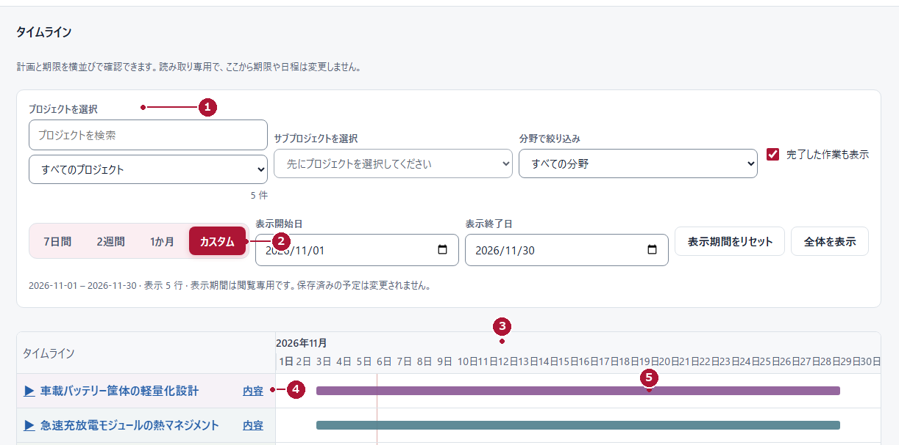
<figcaption>図G06　マネージャー（MANAGER）／タイムライン（架空データ）</figcaption>
</figure>

### 操作

1. 左メニューの「タイムライン」を押します。
2. 「プロジェクトを選択」①で案件を選びます。必要ならサブプロジェクトや分野でも絞ります。
3. 「7日間」「2週間」「1か月」「カスタム」②で表示期間を選びます。カスタムでは表示開始日・表示終了日を指定します。
4. 上の日付の並び③で、期間の範囲を確認します。
5. 行の「内容」④を押すと、その作業の詳細を確認できます。
6. 日程バー⑤で、期間の重なりと余裕を見ます。

**完了の見分け方：** 対象期間に、案件と作業の日程が並んで表示されています。

**次の行動：** 期限の調整が必要なら、対象の作業を開いて第15章の手順で編集します。

> **ここで期限は変わりません**
>
> 画面には「読み取り専用で、ここから期限や日程は変更しません。」と表示されます。表示期間を変えても、保存済みの予定は変わりません。期限を変えるときは、メンバー（MEMBER）は納期変更申請、マネージャー（MANAGER）は編集または申請の判断を使います。

## 第20章　担当・期限レポート

<table class="lesson">
<tr><th>目的</th><td>担当者ごと・案件ごとの件数と期限の状況を確認する。</td></tr>
<tr><th>開始画面</th><td>マネージャー（MANAGER）／「担当・期限レポート」</td></tr>
<tr><th>事前条件</th><td>対象期間と、見たい担当者・分野が決まっている。</td></tr>
</table>

〔要撮影〕担当・期限レポートの画面（対象期間・絞り込み・内訳の表示）。

### 操作

1. 左メニューの「担当・期限レポート」を押します。
2. 「対象期間」を決めます。
3. 「メンバー」「分野」「プロジェクト」で絞り込みます。
4. 表示された件数の意味（対象期限・完了・期限超過など）を確認します。
5. 必要なら担当者や案件の内訳を開き、該当する作業を確認します。

**完了の見分け方：** 対象期間と絞り込みの条件が画面上部に残り、見ている数字が何を数えたものか説明できる状態です。

**次の行動：** 負荷が高い担当者や、期限が近い作業があれば、担当者と相談して第15章で調整します。

### 数字の種類

| 数字 | 数えているもの |
|---|---|
| 対象期限タスク | 対象期間に期限が来る作業 |
| 期間内に完了したタスク | 対象期間に完了した作業（完了日時で判定） |
| 現在期限超過のタスク | いま期限を過ぎている作業 |
| 期間前からの持ち越し | 対象期間より前に始まり、まだ終わっていない作業 |
| 期限未設定のタスク | 期限が入っていない作業 |

> **件数は労働時間ではありません**
>
> 同じ件数でも、作業の難しさや所要時間は違います。件数だけで負荷や成果を判断しないでください。複数の担当者がいる作業では、作業数と担当の延べ人数は一致しません。

第4部　運用と困ったとき

## 第21章　毎日の確認と週次の見直し

### メンバー（MEMBER）の毎日

1. 「自分の担当タスク」で、期限と今日進める作業を確認する。
2. 内容が分からない作業は「詳細を開く」で説明を読み、必要ならマネージャー（MANAGER）へ聞く。
3. 終わった作業は「完了報告」を出す（第5章）。
4. 期限に間に合わない見込みなら、早めに「その他」→「納期変更を申請」で相談する（第6章）。
5. 「自分の申請」で判断メモを確認する（第7章）。

### マネージャー（MANAGER）の毎日

1. 「概要」で期限超過と直近の期限を確認する（第11章）。
2. 「申請一覧」で承認待ちを確認し、判断を返す（第17章・第18章）。
3. 担当・期限・作業内容の不明点を整理する。
4. 必要な編集と判断を行い、結果が画面に反映されたことを確認する。
5. 判断待ちを翌日に持ち越さない。

### 週次の見直し

1. 「タイムライン」で今後2週間の重なりを確認する（第19章）。
2. 「担当・期限レポート」で担当ごとの件数を見る（第20章）。
3. 完了した作業と、止まっている作業を確認する。
4. 期限の変更が必要な作業は、申請の有無を確認してから調整する。
5. 来週の優先を1つ決めて、関係者へ伝える。

> **メールの到着を前提にしない**
>
> 通知が届くことと、画面上で担当・期限が設定されていることは別です。大切な依頼は、口頭やチャットでも伝えてください。

## 第22章　困ったとき

| 困ったこと | 最初に確認すること | 次の行動 |
|---|---|---|
| ログインできない | 案内されたURL、社員番号、入力方法 | 運用担当者へ連絡。他の人のアカウントを使わない |
| メニューが見つからない | 狭い画面では「メニュー」。役割で表示が違う | 役割が違う場合は運用担当者へ |
| 自分の作業が出ない | 検索語、絞り込み、「完了したタスク」 | マネージャー（MANAGER）に担当と公開範囲を確認してもらう |
| メンバーに案件が見えない | 内部公開か、担当が正しいか | マネージャー（MANAGER）が公開範囲を確認する |
| 「編集」が出ない | メンバー（MEMBER）は既存の案件・作業を通常は編集できない | 対象と直したい内容をマネージャー（MANAGER）へ伝える |
| 保存できない | 必須の入力、日付の前後関係、確認のチェック | 画面に示された理由を直す。変更がないときは閉じる |
| 「他の更新と競合しました」 | 他の人が先に更新していないか | 最新の内容を読み直し、必要な変更だけやり直す |
| 完了報告を送れない | 完了メモの記入、受付状態、既存の申請、対象の状態 | メモを記入し、表示された理由を確認する |
| 送信結果が分からない | 「自分の申請」に記録があるか | 連投しない。申請ID・時刻・対象を控えて相談する |
| 完了報告したのに未完了 | 状態が「承認待ち」か | 第7章で判断メモを確認する |
| 期限を過ぎたのに完了にならない | 期限と完了処理を混同していないか | 実作業が終わったら報告し、判断を受ける |
| 親タスクを完了報告できない | 子タスクがあるか | 子タスクを進める |
| 間違えて登録・完了した | 正しい対象と、直したい内容 | マネージャー（MANAGER）または運用担当者へ相談。作り直さない |
| 表示がおかしい | 画面を再読み込みしても同じか | 画面名・操作・メッセージ・時刻を控えて相談する |

### 問い合わせのときに伝えること

1. 画面名（例：「申請一覧」）
2. 対象のタスク名・案件名・申請ID
3. 行った操作と、表示されたメッセージ
4. 発生した時刻

> パスワードは、誰にも伝えないでください。画面の写真を送るときは、氏名や案件名が写っていないか確認します。

## 第23章　操作の違い早見表

| したいこと | メンバー（MEMBER） | マネージャー（MANAGER） |
|---|---|---|
| 自分の作業を見る | 「自分の担当タスク」 | 「自分の担当タスク」 |
| 案件を探す | 「プロジェクト」（閲覧のみ） | 「プロジェクト」（編集可） |
| 新しい作業を登録する | 「新規タスク」「新規サブプロジェクト」「新規プロジェクト」 | 案件の「新規タスク」「新規サブプロジェクト」「新規プロジェクト」 |
| 既存の担当・説明・期限を変える | マネージャー（MANAGER）へ依頼 | 「編集」で変更し「保存」 |
| 終わった作業を伝える | 「完了報告」 | 「完了報告」、または条件を満たす作業の「完了にする」 |
| 完了報告・納期変更を判断する | 判断結果を「自分の申請」で確認 | 「申請一覧」で「承認」「却下」「差し戻し」 |
| 期限を変えたい | 担当作業の「納期変更を申請」 | 「編集」または申請の判断 |
| 日程を見比べる | 「タイムライン」 | 「タイムライン」「担当・期限レポート」 |
| 作業の詳細を見る | 「詳細を開く」 | 一覧・概要から作業名を押す |

## 用語集

| 用語 | 意味 |
|---|---|
| 分野 | 複数の案件をまとめる業務領域 |
| プロジェクト（案件）／サブプロジェクト（工程） | 目的と成果を持つまとまり／案件の中の工程 |
| タスク（作業）／親タスク | 担当者が進める作業／子をまとめる箱（作業として数えない） |
| 主担当 | その作業の責任者 |
| 完了報告／納期変更申請 | 作業を終えたことを伝える申請／期限の変更を相談する申請。どちらも承認されて効力が出る |
| 受付完了／承認待ち | 申請がサーバーに届いた状態／判断を待っている状態 |
| 差戻し／再確認が必要 | 内容の補足が必要な判断／提出後にタスクが変わった申請 |
| 送信結果不明 | 届いたか分からない状態。自動では再送されない |
| タイムライン／担当・期限レポート | 日程を横並びで見る画面（閲覧専用）／担当ごとの件数を確認する画面 |

> **最後に**
>
> 迷ったら「何をする作業か」「誰が担当か」「いつまでか」の3つに戻ってください。実施した後は、「受付」と「完了」を分けて確認しましょう。
