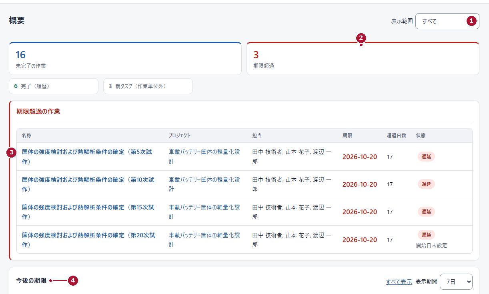
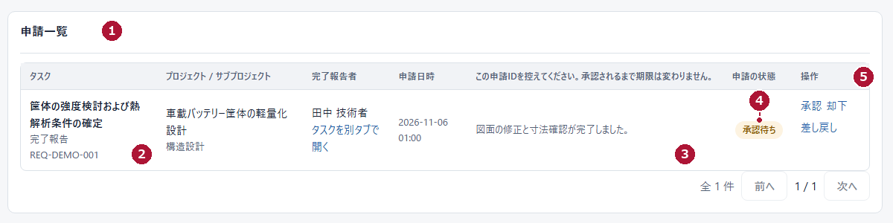

# 設計・開発課 管理 { .qs-title }

## マネージャー（MANAGER）クイックスタート { .qs-sub }

版 1.0｜2026年11月6日｜毎日の3動作と、仕事の組み立て方

**期限と判断待ちを把握する → 対象を確認する → 判断を返す。** この3つが日々の中心です。仕事を新しく作るときは、裏面の「仕事を組み立てる順序」を見てください。

| 手順 | 目的 | 開始画面 | 完了の見分け方 |
|---|---|---|---|
| 1 | 今日の優先を知る | 「概要」 | 期限超過と今後の期限が読める |
| 2 | 対象を確認する | 作業名・「タスクを別タブで開く」 | 内容・担当・期限が読める |
| 3 | 判断を返す | 「申請一覧」 | 状態が承認済・却下・差戻しに変わる |

<figure>

<figcaption>図Q4　マネージャー（MANAGER）／概要（架空データ・操作部分を拡大）</figcaption>
</figure>

### 手順1　今日の優先を知る

1. 左メニューの「概要」を押します。
2. 「表示範囲」①を、見たい範囲に合わせます。
3. 「期限超過」②の件数と、「今後の期限」④の並びを確認します。
4. 気になる作業名③を押して内容を開きます。

> **件数を足し算しない。** 「親タスク（作業単位外）」は子をまとめる箱で、作業として数えません。数え方が違うため、合計を総作業数と考えないでください。

### 週次の見直し

「タイムライン」で今後2週間の重なりを、「担当・期限レポート」で担当ごとの件数を確認します。ここで期限は変わりません。件数は労働時間ではありません。

### 手順2・3　判断待ちを確認し、判断を返す

<figure>

<figcaption>図Q5　マネージャー（MANAGER）／申請一覧（架空データ・操作部分を拡大）</figcaption>
</figure>

1. 「申請一覧」①を開き、取り込み結果（例：「0 件を取り込みました」）を確認します。
2. タスクと種別・申請ID②、内容③、状態④を確認します。必要なら「タスクを別タブで開く」で現在の作業を見ます。
3. 「操作」⑤の「承認」「却下」「差し戻し」を選び、確認画面で対象と内容を読み、「判断メモ」を書いて「確認」を押します。

**承認**は申請を認め（完了報告なら完了、納期変更なら期限を適用）、**却下**は認めず、**差し戻し**は何を直すかを判断メモに書きます。

### 仕事を組み立てる順序

**分野を確認 → プロジェクトを作成 → 必要ならサブプロジェクト → タスクを作成 → 担当・期限・公開範囲を確認**

1. 「プロジェクト」で既存の案件を確認し、必要なら「新規プロジェクト」で作成します（案件名と分野は必須）。案件を開き、必要なら「新規サブプロジェクト」で工程を分けます。
2. 作業を置く場所の「新規タスク」を押し、作成先・作業名・説明・日程を入力します。
3. 担当者を選び、主担当を確認して保存します。複数担当でも、期限・状態・完了判断は1つです。
4. フォーム下部で公開範囲（「社内公開 (INTERNAL)」／「限定 (RESTRICTED)」）を意図して選び、確定します。

**設定完了の目安：** 担当者が自分のアカウントで「自分の担当タスク」を開き、仕事内容・期限・「完了報告」の入口を確認できることです。

> **公開範囲は次回の公開処理から反映されます。** 担当を割り当てただけでは変わりません。

### 困ったとき（まず確認すること）

| 困ったこと | 確認 |
|---|---|
| メンバーに案件が見えない | 公開範囲が「社内公開 (INTERNAL)」か。担当が正しいか |
| 「完了にする」が出ない | 子タスクを持つ親タスクではないか。既に完了していないか |
| 一覧が空・保存できない | 取り込み失敗の警告を確認し「受信箱を同期」を試す。必須の入力、日付の前後関係、競合の表示も確認する |

> **権限外の操作は相談。** アカウント発行・権限付与・完全削除・復元は運用担当者へ。練習用レコードを、実際の環境に作らないでください。
