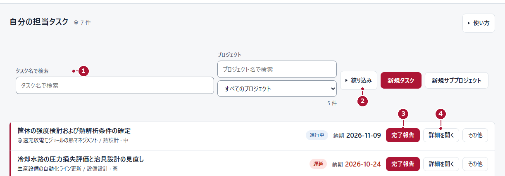
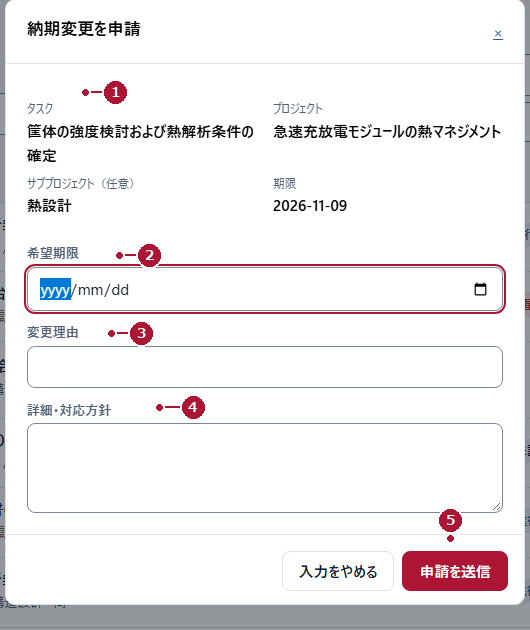
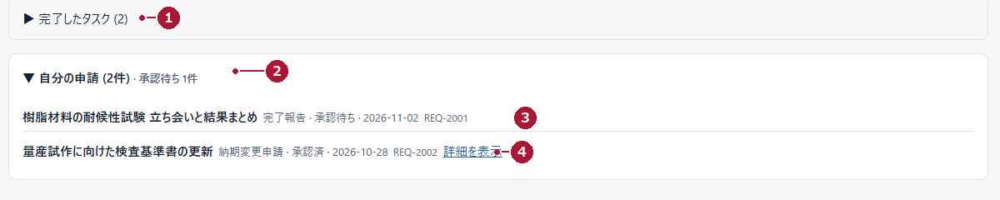

# 設計・開発課 管理 { .qs-title }

## メンバー（MEMBER）クイックスタート { .qs-sub }

版 1.0｜2026年11月6日｜最初の1日で使う操作だけ

**自分の担当を見つける → 内容を確かめる → 終わったら報告する。** この3つができれば、その日の仕事は始められます。全機能は本編の操作マニュアルを参照してください。

| 手順 | 目的 | 開始画面 | 完了の見分け方 |
|---|---|---|---|
| 1 | 自分の担当を見つける | 「自分の担当タスク」 | 一覧に自分の作業と期限が出る |
| 2 | 内容と期限を確かめる | 「詳細を開く」 | 説明・担当・期限が読める |
| 3 | 終わったことを伝える | 「完了報告」 | 「受付完了」と申請IDが出る |
| 4 | 判断を確認する | 「自分の申請」 | 状態（承認待ち・承認済など）が読める |

<figure>

<figcaption>図Q1　メンバー（MEMBER）／自分の担当タスク（架空データ・操作部分を拡大）</figcaption>
</figure>

### 手順1・2　自分の担当を見つけ、内容を確かめる

1. 左メニューの「自分の担当タスク」を押します。
2. 「タスク名で検索」①に名前の一部を入れるか、「絞り込み」②で「期限超過」「今週期限」「承認待ち」を選びます。
3. 対象タスクの「詳細を開く」④を押し、説明・担当・期限を読みます。

**次の行動：** 作業に着手します。期限に間に合わない見込みなら、早めに裏面の「納期変更を申請」へ。

### 手順3　終わったことを伝える

1. 対象タスクの「完了報告」③を押します。
2. フォーム上部のタスク名・期限が対象で正しいか確認し、「完了メモ」に実施した内容を書きます（**空欄では送信できません**）。
3. 「申請を送信」を1回だけ押し、「受付完了」と申請IDを確認します。

> **「受付完了」は、完了ではありません。** 承認されて初めてタスクが完了になります。状態が「承認待ち」の間は、重ねて報告しないでください。

### 手順4　期限の変更を相談する

<figure class="side">

<figcaption>図Q2　メンバー（MEMBER）／納期変更申請（架空データ）</figcaption>
</figure>

1. 対象タスクの「その他」から「納期変更を申請」を選びます。
2. 「希望期限」と「変更理由」を入力し、「詳細・対応方針」に代替案を書きます。
3. 「申請を送信」を1回押します。

**申請しただけでは期限は変わりません。** 承認された後に、タスクの期限を確認してください。

### 手順4（続き）　判断を確認する

<figure>

<figcaption>図Q3　メンバー（MEMBER）／自分の申請（架空データ）</figcaption>
</figure>

「自分の担当タスク」の下部にある「自分の申請」を開き、種別・状態・申請IDを確認します。判断メモは「詳細を表示」で読めます。

| 状態 | 次にすること |
|---|---|
| 承認待ち | 待つ。必要なら口頭で補足する |
| 承認済 | タスクの完了状態、または新しい期限を確認する |
| 差戻し・却下 | 判断メモを読み、内容を直すか別の進め方を相談する |
| 送信結果不明 | 連投しない。申請ID・時刻・対象を控えて相談する |

### 困ったとき（まず確認すること）

| 困ったこと | 確認 |
|---|---|
| 作業が出ない | 検索語と絞り込みを解除する。「完了したタスク」も見る |
| 「編集」がない | 既存の案件・作業は通常は編集できない。マネージャー（MANAGER）へ依頼する |
| 完了報告を送れない・間違えた | 完了メモの記入、状態（完了済み・承認待ち）を確認する。作り直さずマネージャー（MANAGER）へ伝える |

> **練習は本番でしない。** この資料の氏名・案件名はすべて架空です。練習用レコードを、実際に使っている環境に作らないでください。権限・公開範囲・アカウントの相談は運用担当者へ。パスワードは誰にも伝えないでください。
