
設計・開発課 管理

# まずはここから：案件を見つけて、作業を登録する { .cover-title }

メンバー（MEMBER）／マネージャー（MANAGER）クイックスタート　版1.0　2026年11月7日

メニューの全部を説明するのではなく、仕事を進める順に並べています。システム管理者向けの操作は扱いません。

## あなたの役割でできること

| できること | メンバー（MEMBER） | マネージャー（MANAGER） |
|---|---|---|
| 案件・サブプロジェクト・自分のタスクを作る | できる（新規作成のみ） | 管理用フォームで作る |
| 既存の案件・作業を編集する | 通常はできない | できる |
| 担当者を決める・追加する | できない（作成者が主担当になる） | できる |
| 完了報告・納期変更を申請する | できる（条件を満たす作業） | できる |
| 申請を判断する／直接完了にする | できない | 申請一覧、または「完了にする」 |

> **メンバー（MEMBER）は「作る」はできても「直す」はできません。** 自分が作った案件・作業でも、通常の編集はマネージャー（MANAGER）に依頼してください（作り直さない）。

## 仕事のまとまり方

**分野 → プロジェクト → サブプロジェクト（任意）→ タスク**

分野製品設計

→

プロジェクト新型カバーの設計

→

サブプロジェクト<em>任意</em>試作評価

→

タスク試作品の寸法を確認する

**サブプロジェクトは任意です。** 関連する作業をまとめたいときだけ作ります。工程を分ける必要がなければ、タスクをプロジェクトの直下に置きます。サブプロジェクトは「作業のまとまり」、タスクは「実際に行う具体的な行動」です。

## 読み進め方

**メンバー（MEMBER）：** p.2（案件を探す）→ p.3〜5（サブプロジェクト・タスク・確認）→ p.9（タイムライン）→ p.10〜11（完了報告・納期変更）

**マネージャー（MANAGER）：** p.2（案件を探す）→ p.6〜8（構成・タスク作成・編集）→ p.9（タイムライン）→ p.12（申請の判断）

**共通：** p.13（毎日のチェックと困ったとき）

## この資料の前提

**画面写真は架空のデータで表示した確認用の画面**で、実際の環境とは氏名・案件名・件数が異なります（本番環境で確認済みという意味ではありません）。入力例は「製品設計／新型カバーの設計／試作評価／試作品の寸法を確認する」で統一していますが、**画面写真は別の架空の案件で撮影しているため、写真と入力例の名前は一致しません**（写真の文字は書き換えていません）。**練習用のレコードを、実際に使っている環境に作らないでください。**

共通

## 第1章　案件と置き場所を見つける

<table class="procedure">
<tr><th>目的</th><td>重複した案件や、置き場所の違うタスクを増やさない。</td></tr>
<tr><th>対象</th><td>メンバー（MEMBER）・マネージャー（MANAGER）</td></tr>
<tr><th>開始画面</th><td>左メニュー「プロジェクト」</td></tr>
<tr><th>準備する情報</th><td>探したい案件名の一部、それが属する分野</td></tr>
</table>

<figure class="shot wide short">
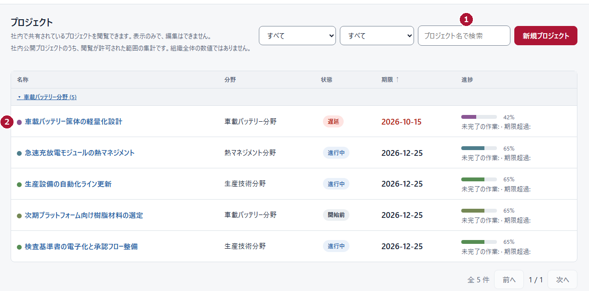
<figcaption>図1-1　メンバー（MEMBER）／プロジェクト一覧（架空データ）。編集の列がないのがメンバー表示</figcaption>
</figure>

<figure class="shot wide short">
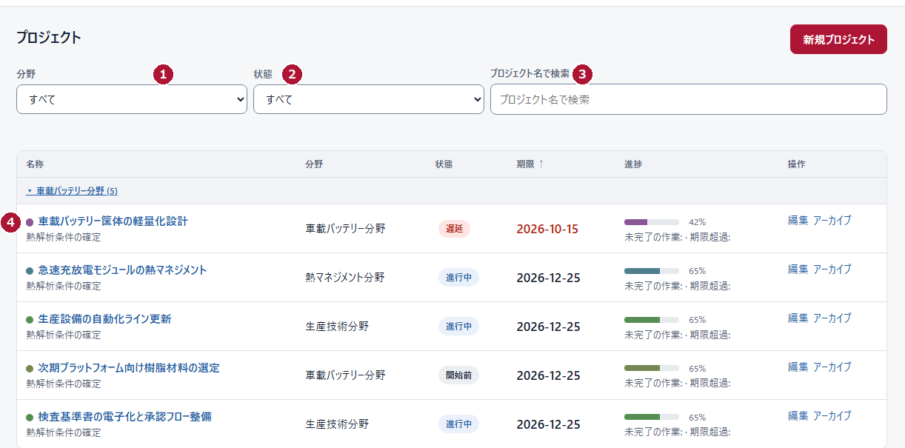
<figcaption>図1-2　マネージャー（MANAGER）／プロジェクト一覧（架空データ）。右端に「編集」「アーカイブ」がある</figcaption>
</figure>

### 操作

① 左メニューの「プロジェクト」を開きます。

② 名称の一部が分かっているときは検索欄に入力し、分野・状態で絞り込みます（メンバーは図1-1の①。マネージャーは図1-2の①②③。メンバーの画面では、検索欄の左にある2つの選択欄が同じ役割です）。

③ 目的の案件名を押して開きます（メンバーは図1-1の②、マネージャーは図1-2の④）。

④ 開いた画面で、案件名・分野・責任者・公開範囲・「プロジェクト構成」を読みます。

### 次にどうするか

| 状況 | 次にすること |
|---|---|
| 目的の作業をまとめた工程がすでにある | その工程の中にタスクを作る（メンバー p.4／マネージャー p.7） |
| 工程がない | 作業が1〜2件ならプロジェクト直下にタスク（p.4／p.7）、まとめたいならサブプロジェクト（p.3／p.6） |

**完了の確認：** 開いた案件名と、その上に出る「プロジェクト / 案件名」の階層が、自分の思っている案件と一致しています。

**困ったとき：** 同じような名前の案件が複数ある場合は、分野・責任者・期限で見分けます。判断できないときは、作る前にマネージャー（MANAGER）へ確認してください。**作る前に検索する**（探さずに作ると同じ案件が2つできます）。**タスクを割り当てても、案件の公開範囲は変わりません。**

メンバー（MEMBER）

## 第2章　サブプロジェクトを作る

<table class="procedure">
<tr><th>目的</th><td>既存の案件の下に、作業のまとまりを作る。</td></tr>
<tr><th>対象</th><td>メンバー（MEMBER）</td></tr>
<tr><th>開始画面</th><td>「自分の担当タスク」右上の「新規サブプロジェクト」</td></tr>
<tr><th>準備する情報</th><td>作成先の案件名、まとめたい作業の範囲、サブプロジェクト名</td></tr>
</table>

〔要撮影・差し込み位置〕

メンバー（MEMBER）の「新規サブプロジェクト」入力画面。作成先の選択、親サブプロジェクト、名称、作成ボタンが写る範囲。撮影条件は REVIEW_NOTES.md の S-01 を参照。ここには別画面の写真を代用として置いていません。

### 操作

① 「自分の担当タスク」右上の「新規サブプロジェクト」を押します。

② 「作成する内容」で「サブプロジェクトを作成」を選びます。

③ 「プロジェクト」で、作成先の案件を選びます。

④ さらに階層を分けるときだけ「親サブプロジェクト（任意）」を選びます。分けないときは「指定しない（最上位）」のままにします。

⑤ 「サブプロジェクト名」を入力します（例：試作評価）。

⑥ 目的が分かる短い説明を書きます（任意。あとから見る人の助けになります）。

⑦ 画面に表示されている作成ボタンを押します。

### 作成前に決めておくこと

| 決めること | 例（架空） | 補足 |
|---|---|---|
| 作成先の案件 | 新型カバーの設計 | 既存の案件から選ぶ。新しい案件を作らない |
| 親サブプロジェクト | 指定しない（最上位） | 工程をさらに分けるときだけ選ぶ |
| サブプロジェクト名 | 試作評価 | 何をまとめるかが分かる名前 |
| 説明 | 試作品の評価と測定をまとめる | 任意。目的を1文で書くと伝わる |

**完了の確認：** 対象の案件の「プロジェクト構成」に、作成した名前が表示されています。意図した親の下に入っているかも確認します。

**次にすること：** その中にタスクを作ります（p.4）。

**困ったとき：** 違う案件・違う親の下にできた場合は、同じものを作り直さず、対象名と直したい内容をマネージャー（MANAGER）へ伝えてください。

> **これは「新規作成」で、承認申請ではありません。** 押した時点で作られます。承認を待つ画面はありません。
>
> **担当者を選ぶ欄はありません。** メンバー（MEMBER）が作るサブプロジェクトに、担当者を割り当てる操作は案内できません。担当者の設定はマネージャー（MANAGER）の作業です。
>
> **画面にない必須項目を作らない。** 実際のフォームに表示されていない項目は、入力不要です。表示されている項目だけを埋めてください。

## 第3章　タスクを作る

<table class="procedure">
<tr><th>目的</th><td>既存の案件に、自分が担当する具体的な作業を追加する。</td></tr>
<tr><th>対象</th><td>メンバー（MEMBER）</td></tr>
<tr><th>開始画面</th><td>「自分の担当タスク」右上の「新規タスク」</td></tr>
<tr><th>準備する情報</th><td>作成先の案件（と工程）、作業名、終了日、作業内容</td></tr>
</table>

<figure class="shot narrow">
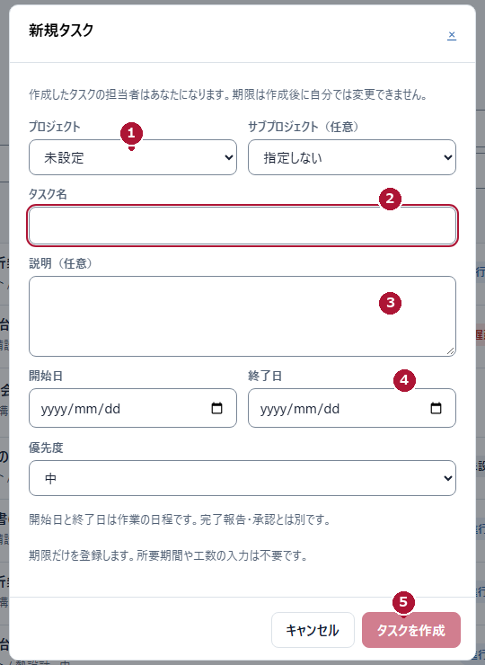
<figcaption>図3-1　メンバー（MEMBER）／新規タスク（架空データ）</figcaption>
</figure>

### 操作

① 「新規タスク」を押し、「プロジェクト」を選びます（図3-1の①）。工程がある場合は、右隣の「サブプロジェクト（任意）」も確認します。

② 「タスク名」に、何をするか分かる名前を入力します（②。例：試作品の寸法を確認する）。

③ 「説明（任意）」に、対象・成果物・確認してほしいことを書きます（③。例：主要寸法を測定し、図面との差異を確認する。）。

④ 「開始日」と「終了日」を入力します（④。終了日は必須。開始日は分かるときだけ）。

⑤ 優先度を選び、「タスクを作成」を押します（⑤）。

**完了の確認：** ダイアログが閉じ、「自分の担当タスク」の一覧に、作成した作業が表示されます。作成先の案件名も行の下に出ます。

**次にすること：** 一覧で期限と作成先を確認します（p.5）。着手したら、終わったときに完了報告を出します（p.10）。

### 入力の必須と推奨

| 項目 | 扱い | 補足 |
|---|---|---|
| プロジェクト | 必須 | 既存の案件から選ぶ |
| サブプロジェクト | 任意 | 作成先から開いた場合は、すでに入っていることがある |
| タスク名 | 必須 | 「何をするか」が分かる名前にする |
| 説明 | 任意（記入を推奨） | 内容が共有され、判断が早くなる |
| 開始日 | 任意 | 入れる場合は終了日より後にしない |
| 終了日 | 必須 | 期限。作成後に自分では変更できない |
| 優先度 | 選択 | 画面の選択肢から選ぶ（初期のままでよい） |

> **作成した人は、その作業の主担当になります。** 画面にも「作成したタスクの担当者はあなたになります」と表示されます。ほかの人に割り当てたいときは、マネージャー（MANAGER）に依頼してください。
>
> **開始日と終了日は作業の予定です。** 完了報告・承認とは別の項目です。画面にあるとおり、期間の長さから工数を入力する必要はありません。
>
> **作っただけでは完了になりません。** 期限が来ても自動では完了しません。

**困ったとき：** 保存できないときは、画面の理由（必須の入力、日付の前後関係）を直します。作成できたか分からないときは、一覧を再読み込みして確認します。

## 第4章　タスクを確認する・間違えたとき

<table class="procedure">
<tr><th>目的</th><td>自分の作業の内容・期限・作成先を確かめ、行き違いを早く見つける。</td></tr>
<tr><th>対象</th><td>メンバー（MEMBER）</td></tr>
<tr><th>開始画面</th><td>「自分の担当タスク」</td></tr>
<tr><th>準備する情報</th><td>確認したい作業の名前（一部でよい）</td></tr>
</table>

<figure class="shot wide">
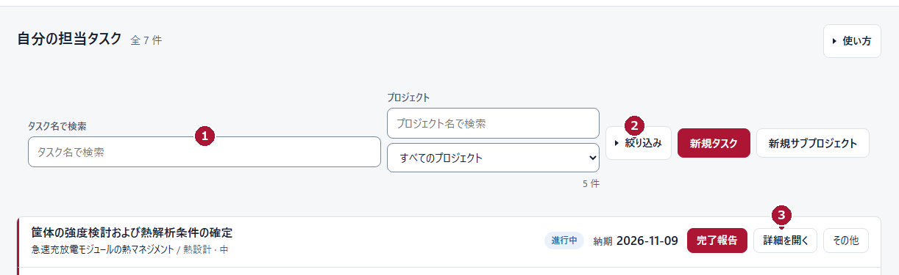
<figcaption>図4-1　メンバー（MEMBER）／自分の担当タスク（架空データ）</figcaption>
</figure>

### 操作

① 「タスク名で検索」に名前の一部を入れて探します（図4-1の①）。

② 条件で絞るときは「絞り込み」を開きます（②。「期限超過」「今週期限」「承認待ち」など）。

③ 内容を確かめたい作業の「詳細を開く」を押します（③）。説明・担当・期限を読みます。

<figure class="shot strip">
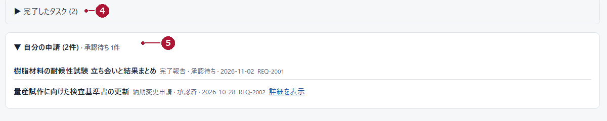
<figcaption>図4-2　メンバー（MEMBER）／画面下部の「完了したタスク」と「自分の申請」（架空データ）</figcaption>
</figure>

④ 見つからないときは、画面下部の「完了したタスク」を開きます（図4-2の④）。終わった作業はここに入ります。

⑤ 申請した覚えがあるときは「自分の申請」を開きます（⑤）。状態と判断メモを確認できます。

**完了の確認：** 対象の作業の名前・作成先・期限が、自分が思っている内容と一致しています。

**次にすること：** 作業に着手します。終わったら p.10、期限に間に合わない見込みなら p.11 へ。

### こうなったら、こうする

| 状況 | すること |
|---|---|
| 名前・作成先・期限が違う | マネージャー（MANAGER）に、対象と直したい内容を伝える。作り直さない |
| 作業が見つからない | 検索語と絞り込みを解除する。「完了したタスク」も見る |
| それでも見つからない | 案件名と自分の担当を、マネージャー（MANAGER）に確認してもらう |
| 作成の入口が出ない | 自分の役割と、選べる有効な案件があるかを確認する |
| 保存できない | 画面に出た理由（必須の入力、日付の前後関係）を直す。成功したと思い込まない |
| 作成できたか分からない | 一覧を再読み込みし、同じ作業がすでにないか確認する |

> **既存の作業を自分で編集する手順はありません。** メンバー（MEMBER）は、自分が作った作業も通常は編集できません。

マネージャー（MANAGER）

## 第5章　案件の構成を作る

<table class="procedure">
<tr><th>目的</th><td>担当者が自分の作業を見つけられるように、案件の中を整理する。</td></tr>
<tr><th>対象</th><td>マネージャー（MANAGER）</td></tr>
<tr><th>開始画面</th><td>「プロジェクト」→ 対象の案件</td></tr>
<tr><th>準備する情報</th><td>案件名、分けたい工程の範囲、工程の名前</td></tr>
</table>

<figure class="shot wide mid">
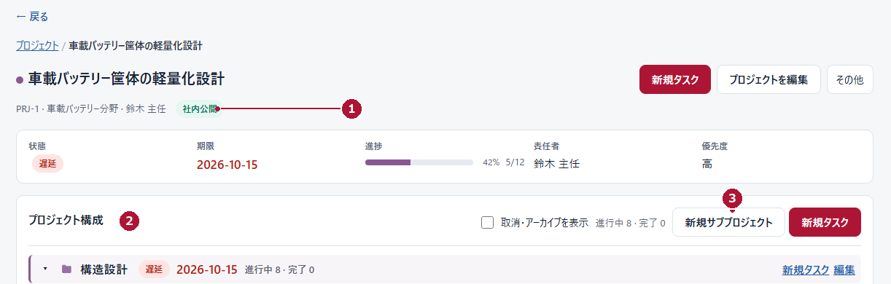
<figcaption>図5-1　マネージャー（MANAGER）／案件詳細とプロジェクト構成（架空データ）</figcaption>
</figure>

### 操作

① 「プロジェクト」から対象の案件を開き、案件名・分野・責任者・公開範囲を確認します（図5-1の①）。

② 画面を下へスクロールし、「プロジェクト構成」を見ます（②）。すでにある工程と作業が並びます。

③ 工程を追加するときは「新規サブプロジェクト」を押します（③）。

〔要撮影・差し込み位置〕

マネージャーの「新規サブプロジェクト」フォーム。撮影条件は REVIEW_NOTES.md の S-02。代用の写真は置いていません。

④ フォームで工程名を入力し、作成先の案件（と親）が正しいか確認して確定します。

⑤ 追加した工程の行にある「新規タスク」（図5-1の「新規タスク」列）から、その工程に作業を追加できます（p.7）。

⑥ 上部の「新規タスク」を使うと、案件の直下に作業を追加できます。

**完了の確認：** 「プロジェクト構成」に、意図した階層で工程が表示され、その下に作業を追加できる状態になっています。

**次にすること：** 作業を作り、担当と日程を決めます（p.7）。

**困ったとき：** 階層が意図と違うときは、作り直さずにその場で修正します。階層の上限を超える親は選べません。上限や選択肢の案内は画面の表示に従ってください。

> **まとまりを増やしすぎない。** 工程を細かく分けるほど、担当者は目的の作業を探しにくくなります。担当者が自分の作業にたどり着けるかを基準にしてください。
>
> **この手順では、責任者の変更や管理者向けの設定は扱いません。** 責任者を変えたいとき、公開範囲の判断に迷うときは、上位の管理者に相談してください。

## 第6章　タスクを作成し、担当を決める

<table class="procedure">
<tr><th>目的</th><td>作業内容・日程・担当を決めて、責任の所在をはっきりさせる。</td></tr>
<tr><th>対象</th><td>マネージャー（MANAGER）</td></tr>
<tr><th>開始画面</th><td>案件または工程の「新規タスク」</td></tr>
<tr><th>準備する情報</th><td>作成先、作業名、作業内容、開始日・終了日、主担当</td></tr>
</table>

<figure class="shot wide mid">
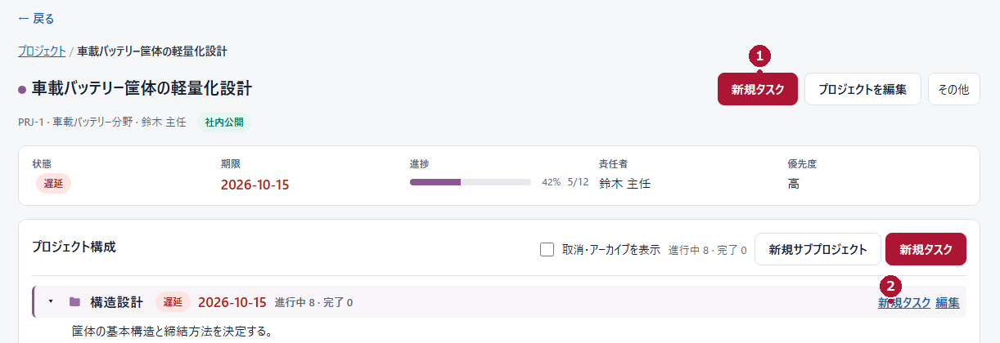
<figcaption>図6-1　マネージャー（MANAGER）／「新規タスク」の入口は2か所（架空データ）</figcaption>
</figure>

### 操作

① 案件を開き、画面上部の「新規タスク」を押します（図6-1の①）。案件の直下に作業を作るときに使います。

② 工程の中に作るときは、その工程の行にある「新規タスク」を押します（②）。

〔要撮影・差し込み位置〕

マネージャーの「新規タスク」フォーム（作成先、タスク名、説明、日程、担当者、保存）。撮影条件は REVIEW_NOTES.md の S-03。編集フォームの写真を代用しません。

③ フォーム上部の「作成先」が、意図した案件・工程になっているか確認します（違うときは「作成先を変更」）。

④ 「タスク名」に具体的な行動を書きます（例：試作品の寸法を確認する）。「説明」には対象・成果物・確認してほしいことを書きます（例：主要寸法を測定し、図面との差異を確認する。）。

⑤ 「開始日」と「終了日」を入力します。終了日は必須です。

⑥ 「担当者」で主担当を選びます。追加する人だけ「担当者を追加」から加えます。

⑦ 優先度を選び、必要な確認メッセージ（休日の期限など）を読んでから保存の操作を押し、階層と詳細画面で内容を確認します。

**完了の確認：** 「プロジェクト構成」の意図した場所に作業が表示され、詳細画面に担当・期限・状態が出ています。

**次にすること：** 担当者へ依頼内容を伝えます。作業が終わったら、報告または判断の手順へ進みます（p.10〜12）。

### 担当の決まり

- **主担当は、その作業の責任者です。** 画面にも「先頭の担当者が主担当として記録されます。担当者は権限ではなく、作業の責任者を表します」と表示されます。
- **追加担当者は、マネージャーの権限を得ません。** 担当者が複数でも作業は1つで、期限・状態・完了の判断も1つです。担当者ごとの進捗率は入力しません。

> **メールが届くことを前提にしない。** 担当を設定したことと通知が届くことは別です。**日程は工数ではありません。**

**困ったとき：** 「作成先」が意図と違うときは、保存せずに「作成先を変更」から選び直します。

## 第7章　既存の作業を安全に編集する

<table class="procedure">
<tr><th>目的</th><td>担当・日程・内容を、ほかの人の更新を壊さずに直す。</td></tr>
<tr><th>対象</th><td>マネージャー（MANAGER）</td></tr>
<tr><th>開始画面</th><td>作業の詳細画面</td></tr>
<tr><th>準備する情報</th><td>直したい項目だけ（担当、日程、名前、説明）</td></tr>
</table>

<figure class="shot narrow">
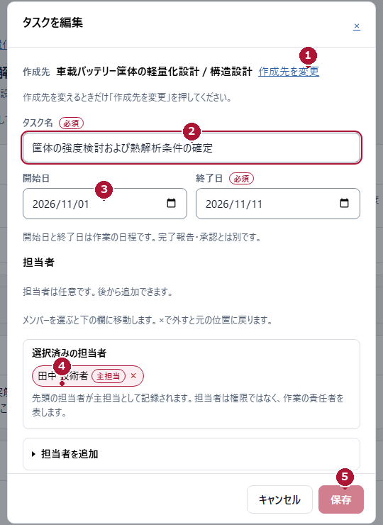
<figcaption>図7-1　マネージャー（MANAGER）／タスクを編集（架空データ）</figcaption>
</figure>

### 操作

① 一覧・概要・タイムラインから、対象の作業を開きます。

② 「編集」を押して、フォームを開きます。

③ 上部の「作成先」を確認します（図7-1の①）。変えるときだけ「作成先を変更」を押します。

④ 「タスク名」を確認します（②）。

⑤ 「開始日」「終了日」を確認します（③）。終了日は必須です。

⑥ 「選択済みの担当者」を確認します（④）。変えるときは、追加・削除の操作で並べ替えます。先頭の人が主担当です。

⑦ 「保存」を押します（⑤）。

⑧ 詳細画面に戻り、担当・期限・状態が保存した内容になったことを確認します。

<figure class="shot crop">
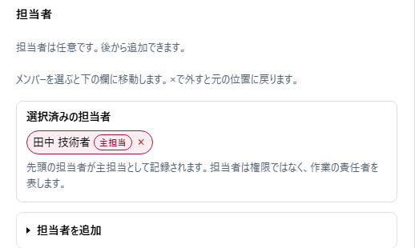
<figcaption>図7-2　担当者欄の拡大（架空データ）。主担当は先頭に表示される</figcaption>
</figure>

**完了の確認：** 詳細画面の「担当者」と「納期」が、編集後の値になっています。

**次にすること：** 担当が変わったときは、新しい担当者へ内容と期限を伝えます。

**困ったとき：**

| 状況 | すること |
|---|---|
| 変更する項目がない | 保存せずに「キャンセル」で閉じる |
| 保存前に閉じたい | 「キャンセル」または Escape。保存前なら編集は反映されない |
| 「他の更新と競合しました」と出た | 最新の内容を読み直し、必要な変更だけやり直す |
| 期限を変えたときの確認が出た | 内容を読み、意図した変更か確かめてから確定する |
| 誤って登録した | 作り直さず、その作業を直す。別の作業を新しく作らない |

> **日程から進捗や完了を推測しない。** 期限が過ぎたこと、開始日が来たことは、作業の進み具合とは別です。状態は報告と判断で決まります。

共通

## 第8章　タイムラインで予定を見る

<table class="procedure">
<tr><th>目的</th><td>案件と期限を横に並べて見て、重なりと余裕を確認する。</td></tr>
<tr><th>対象</th><td>メンバー（MEMBER）・マネージャー（MANAGER）</td></tr>
<tr><th>開始画面</th><td>左メニュー「タイムライン」</td></tr>
<tr><th>準備する情報</th><td>見たい案件、見たい期間</td></tr>
</table>

<figure class="shot wide">
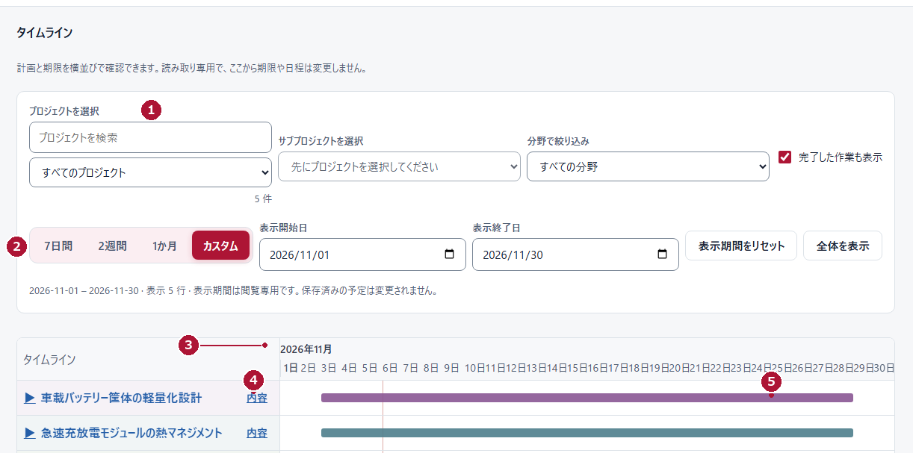
<figcaption>図8-1　タイムライン（マネージャー表示・架空データ）。画面の案内どおり、ここから期限は変更しない</figcaption>
</figure>

### 操作

① 「プロジェクトを選択」で案件を選びます（図8-1の①）。必要ならサブプロジェクトや分野でも絞ります。

② 表示期間を選びます（②。「7日間」「2週間」「1か月」「カスタム」）。

③ チャート上部の日付の並びで、表示している範囲を確認します（③）。「カスタム」では表示開始日・表示終了日を指定できます。

④ 行の「内容」を押すと、その作業の詳細を開けます（④）。

⑤ 日程バーで、期間の重なりと余裕を見ます（⑤）。表が横に長いときは、その領域を横にスクロールします。

**完了の確認：** 対象期間に、案件と作業の日程が並んで表示され、重なりが読めています。

**次にすること：** 調整が必要な作業が見つかったら、その作業を開いて編集します（p.8）。メンバー（MEMBER）は、自分の担当作業なら納期変更を申請します（p.11）。

> **ここは読むだけの画面です。** 画面にも「読み取り専用で、ここから期限や日程は変更しません」と表示されます。バーをドラッグして期限を動かす操作はありません。
>
> **表示期間を変えても、期限は変わりません。** 見ている範囲が変わるだけです。
>
> **色は案件を見分けるための目印です。** 色だけで遅延や優先度を判断せず、状態の文字と期限を見てください。開始日が入っていない作業は「開始日未設定」のように表示されます。
>
> この図は**マネージャー（MANAGER）の画面**です。メンバー（MEMBER）の画面では、左メニューに表示される項目が異なります。

**困ったとき：** 作業が見つからないときは、案件と分野の絞り込み、表示期間を確認します。メンバー（MEMBER）は「自分の担当タスク」からも開けます。

メンバー（MEMBER）

## 第9章　完了を報告する

<table class="procedure">
<tr><th>目的</th><td>終えた作業の内容をマネージャー（MANAGER）に伝え、判断を依頼する。</td></tr>
<tr><th>対象</th><td>メンバー（MEMBER）</td></tr>
<tr><th>開始画面</th><td>「自分の担当タスク」の対象行の「完了報告」</td></tr>
<tr><th>準備する情報</th><td>実施した内容、確認した結果、引き継ぎ事項</td></tr>
</table>

<figure class="shot narrow">
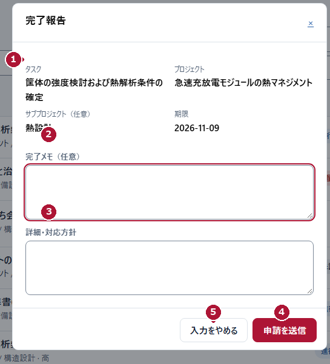
<figcaption>図9-1　メンバー（MEMBER）／完了報告（架空データ）</figcaption>
</figure>

### 操作

① 対象の作業の行にある「完了報告」を押します（このボタンは図9-1に写っていません）。

② 上部の「タスク」「プロジェクト」「期限」が、対象で正しいか確認します（図9-1の①）。

③ 「完了メモ（任意）」に、実施した内容を書きます（②。例：主要寸法の確認を完了し、図面との差異がないことを確認しました。）。

④ 補足や引き継ぎがあれば「詳細・対応方針」に書きます（③）。

⑤ 「申請を送信」を1回だけ押します（④）。

⑥ 「受付完了」と申請IDが表示されたら内容を控え、「自分の申請」で判断を待ちます。

**完了の確認：** 「受付完了」と申請IDが表示されています。この時点で**タスクはまだ完了していません**。状態は「承認待ち」です。

### 受付完了のあとに見るもの

| 画面の表示 | 意味 | あなたの行動 |
|---|---|---|
| 受付完了 | 申請が届いた | 申請IDを控える。重ねて送信しない |
| 承認待ち | 判断を待っている | 待つ。急ぐときは口頭で補足する |
| 承認済 | 判断された | タスクが完了になったことを確認する |
| 差し戻し・却下 | 認められなかった、または補足が必要 | 判断メモを読み、相談する |

**次にすること：** 「自分の担当タスク」下部の「自分の申請」を開き、判断メモを確認します。承認されると、タスクが完了になります。

**困ったとき：**

| 状況 | すること |
|---|---|
| 「完了報告」が出ない | 完了済み、承認待ち、子タスクを持つ親タスク、受付停止のいずれか。状態を確認する |
| 送信できないと表示された | 画面の理由（完了メモが空、既に申請がある など）を直す |
| 送信中に閉じてしまった | 送信は取り消されていない。「自分の申請」を確認する |
| 「送信結果不明」と出た | 連投しない。申請ID・時刻・対象を控えてマネージャー（MANAGER）へ相談する |

> **「任意」と表示されていても、空欄では送信できません。** 必ず内容を記入してください（この表記の不一致は REVIEW_NOTES.md の D-01 に記録しています）。**受付完了は、完了ではありません。** 承認されて初めて完了になります。承認待ちの間は、重ねて報告しないでください。

## 第10章　納期変更を申請する

<table class="procedure">
<tr><th>目的</th><td>担当している作業の期限について、希望日と理由を伝える。</td></tr>
<tr><th>対象</th><td>メンバー（MEMBER）</td></tr>
<tr><th>開始画面</th><td>「自分の担当タスク」の対象行の「その他」</td></tr>
<tr><th>準備する情報</th><td>希望する期限、変更が必要な理由、遅れを取り戻す案</td></tr>
</table>

<figure class="shot narrow">
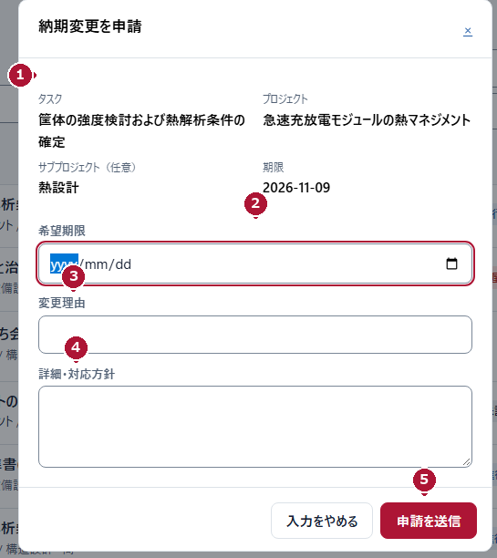
<figcaption>図10-1　メンバー（MEMBER）／納期変更申請（架空データ）</figcaption>
</figure>

### 操作

① 「自分の担当タスク」で対象の作業を探します。

② その行の「その他」を押し、「納期変更を申請」を選びます。

③ 上部の「タスク」と「期限」で、対象と現在の期限を確認します（図10-1の①）。

④ 「希望期限」に、変更したい日付を入力します（②）。

⑤ 「変更理由」に理由を書きます（③。例：評価治具の入荷が遅れています）。

⑥ 「詳細・対応方針」に、遅れを取り戻す案や相談したい範囲を書きます（④）。

⑦ 「申請を送信」を1回押し、「受付完了」を確認します（⑤）。

**完了の確認：** 「受付完了」と申請IDが表示されています。**この時点では期限は変わっていません。**

### 書き方の例（架空）

対象：プロジェクト「新型カバーの設計」／サブプロジェクト「試作評価」／タスク「試作品の寸法を確認する」

- 希望期限：当初の期限から5営業日後
- 変更理由：測定に使う三次元測定機が、別案件の対応で2日間使用できないため
- 詳細・対応方針：空いた時間で図面との照合を先に進めます。日程の再調整が必要なら相談させてください

**次にすること：** 「自分の申請」で判断を確認します。承認されたら、対象の作業の期限が新しい日付になっていることを確かめます。

**困ったとき：**

| 状況 | すること |
|---|---|
| 「その他」に項目がない | 対象が完了済み、または自分が担当していない。状態を確認する |
| 期限が変わらない | 承認待ちかどうかを確認する。申請だけでは変わらない |
| 却下・差し戻しだった | 判断メモを読み、内容を直すか別の進め方を相談する |
| 「送信結果不明」と出た | 連投しない。申請ID・時刻・対象を控えて相談する |

> **申請は担当している作業が対象です。** ほかの人の作業については、マネージャー（MANAGER）に相談してください。
>
> **希望期限は必須です。** 理由と対応方針は推奨ですが、書かれていると判断が早くなります。

マネージャー（MANAGER）

## 第11章　申請を判断する・直接完了にする

<table class="procedure">
<tr><th>目的</th><td>届いた申請を読み、申請者が次へ進める判断を返す。</td></tr>
<tr><th>対象</th><td>マネージャー（MANAGER）</td></tr>
<tr><th>開始画面</th><td>左メニュー「申請一覧」</td></tr>
<tr><th>準備する情報</th><td>対象の作業の状況、申請者へ伝える内容</td></tr>
</table>

<figure class="shot wide mid">
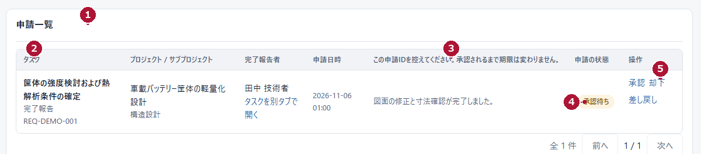
<figcaption>図11-1　マネージャー（MANAGER）／申請一覧（架空データ・操作部分を拡大）</figcaption>
</figure>

### 操作（申請を判断する）

<figure class="shot narrow">
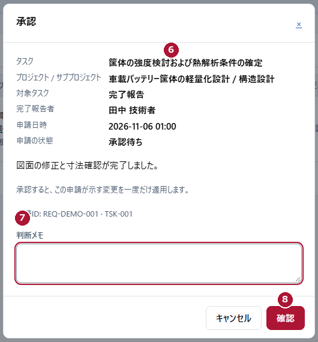
<figcaption>図11-2　マネージャー（MANAGER）／承認の確認画面（架空データ）</figcaption>
</figure>

① 「申請一覧」を開きます（図11-1の①）。上部の取り込み結果（例：「0 件を取り込みました」）を確認します。

② タスク名・種別・申請IDを確認します（②）。

③ 申請内容を読みます（③）。

④ 「申請の状態」が「承認待ち」であることを確認します（④）。

⑤ 「操作」の「承認」「却下」「差し戻し」のいずれかを押します（⑤）。

⑥ 確認画面で「タスク」と「対象タスク」が正しいか確認します（図11-2の⑥）。

⑦ 「判断メモ」に、申請者へ伝える内容を書きます（⑦）。

⑧ 「確認」を押します（⑧）。一覧に戻り、申請の状態と対象の作業の結果を確認します。

### 操作（自分で完了を判断する）

⑨ 作業の詳細で「完了にする」を押します。確認メッセージを読み、対象が正しいときだけ確定します。これは申請の承認とは別のルートで、作業詳細の画面上部に「編集」「タスクを追加」と並んで表示されます。

**完了の確認：** 申請の状態が「承認済」「却下」「差し戻し」に変わり、対象の作業の状態または期限が反映されています。**次にすること：** 申請者へ結果を伝え、判断メモを見るよう案内します。

### 判断の違い

- **承認：** 完了報告なら完了、納期変更なら期限を適用する。
- **却下・差し戻し：** 却下は何も変えない。差し戻しは状態が変わり、何を直すかを判断メモに書く。
- **完了にする（直接）：** 申請を経ずに完了にする。承認待ちの報告は取り下げ扱いになる。

> **承認と直接完了を重ねない。** 同じ作業で両方を行わないでください。**「最新ではありません」と出た申請は、そのまま承認しない。** **一覧が空でも、申請がないと決めつけない。** 取り込みに失敗すると警告が出ます。警告があるときは「受信箱を同期」を試してください。

**困ったとき：** 判断の対象が分からないときは、「タスクを別タブで開く」で現在の作業を確認してから判断します。

共通

## 第12章　毎日のチェックと困ったとき

<figure class="shot wide">
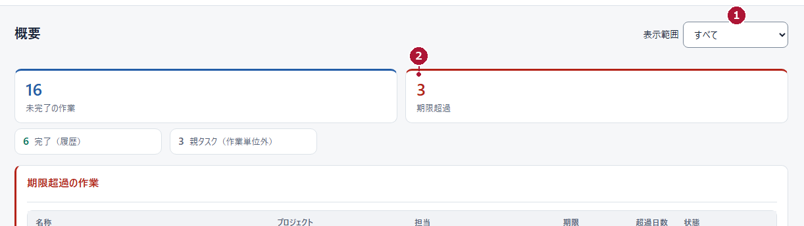
<figcaption>図12-1　マネージャー（MANAGER）／概要（架空データ）。件数はそれぞれ数え方が違う</figcaption>
</figure>

### メンバー（MEMBER）の毎日

- 「自分の担当タスク」で、期限と今日進める作業を確認する（図12-1はマネージャーの画面。メンバーは自分の担当一覧を使う）。
- 内容が分からない作業は「詳細を開く」で説明を読む。
- 終わった作業は完了報告を出す（p.10）。
- 期限に間に合わない見込みなら、早めに納期変更を申請する（p.11）。
- 申請したら「自分の申請」で判断メモを読む。

### マネージャー（MANAGER）の毎日

- 「概要」の「表示範囲」（図12-1の①）を合わせ、「期限超過」（②）と「今後の期限」を確認する。
- 件数は数え方が違う。「親タスク（作業単位外）」は作業として数えない。合計を総作業数と考えない。
- 「申請一覧」で承認待ちを確認し、判断を返す（p.12）。
- 「タイムライン」で今後2週間の重なりを見る（p.9）。
- 保存・判断のあとは、画面に反映されたことを確認する。

### 困ったとき

| 困ったこと | 最初に確認すること | 次の行動 |
|---|---|---|
| 作業が見つからない | 検索語・絞り込み・「完了したタスク」 | マネージャー（MANAGER）に担当と公開範囲を確認してもらう |
| 編集・作成のボタンがない | 自分の役割と、対象の状態 | 編集はマネージャー（MANAGER）へ。作成先に有効な案件があるか確認 |
| 案件・工程の場所が違う | 作成先、親の指定 | 作り直さず、マネージャー（MANAGER）へ相談 |
| 保存できない | 必須の入力、日付の前後関係、競合の表示 | 理由を直す。変更がないときは閉じる |
| 完了報告が承認待ちのまま | 申請の状態 | 判断を待つ。急ぐときは口頭で補足する |
| 送信結果が不明 | 「自分の申請」に記録があるか | 連投しない。申請ID・時刻・対象を控えて相談 |
| タイムラインの期間を変えたのに期限が変わらない | 画面の案内（読み取り専用） | 期限は編集または申請で変える |
| 自分の役割ではできない操作がある | 役割の違い（p.1） | 運用担当者または上位の管理者へ相談 |

**完了の確認：** どの手順も、最後に「画面に反映されたか」を自分の目で確かめてから次へ進みます。

**問い合わせのときに伝えること：** 画面名（例：「申請一覧」）、対象の作業名・案件名・申請ID、行った操作、表示されたメッセージ、発生した時刻。パスワードは誰にも伝えないでください。